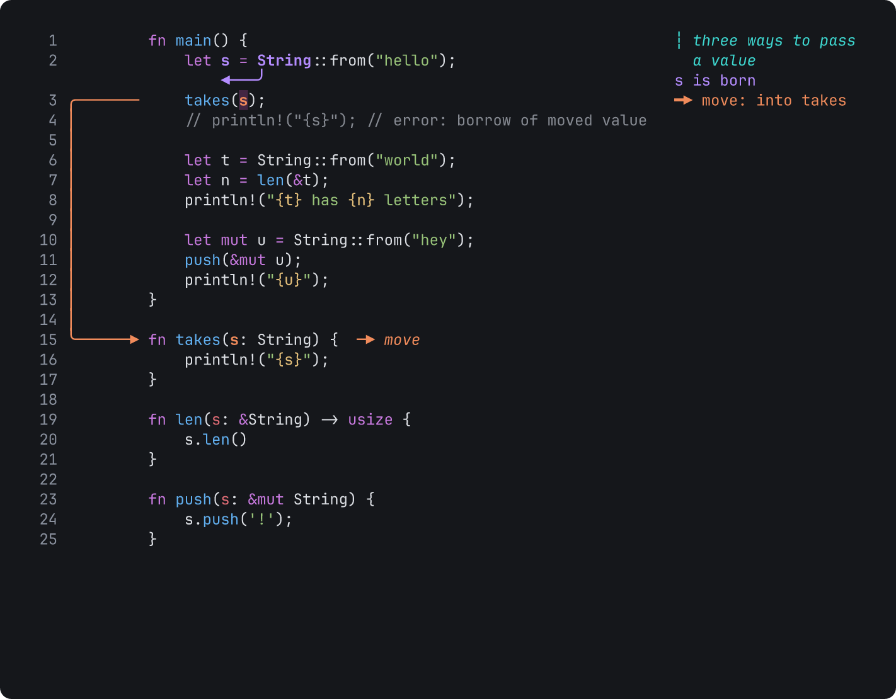

<p align="center"></p>

**Draw on top of code in your terminal to explain, debug and teach.**

Tiza shows your code in the terminal. You draw boxes, arrows, highlights and notes on the code, and you show them step by step.

Use Tiza to explain code to a person or to an AI agent. Examples are a code walkthrough, a lesson, a pull request review, a debug session with an AI agent and a video. AI agents can also draw on the same code through MCP (the Model Context Protocol).

The annotations follow the code text. They keep their place when you scroll, resize the terminal or change the theme.

> Status: **v0.2.0**, early. The document format and the API can change before 1.0.

## Installation

On macOS, and on Linux x86_64 with glibc 2.35 or later, run this command to install the latest release:

```sh
curl -fsSL https://raw.githubusercontent.com/luiscarlosjayk/tiza/main/install.sh | sh
```

The script checks the SHA-256 checksum of the download. Then it puts `tiza` in `~/.local/bin`. It does not use `sudo`. If `~/.local/bin` is not in your `PATH`, the script shows the line to add. For the options of the script, the archives and the macOS download, read [Install Tiza](https://github.com/luiscarlosjayk/tiza/blob/main/docs/guides/install.md).

With Rust 1.88 or later, you can also install from crates.io:

```sh
cargo install tiza
```

## Quick start

Copy this block into your terminal. It writes a small Rust file and opens it in Tiza:

```sh
cat > hello.rs <<'EOF'
fn main() {
    let s = String::from("hello");
    takes(s);
}

fn takes(s: String) {
    println!("{s}");
}
EOF
tiza hello.rs
```

In Tiza, type each of these commands and press Enter:

```text
:note 2 s is born
:arrow 2:s 6:s: move
:step 2
:box 6-8 takes owns s
```

Tiza opens the file at step 1, so the note and the arrow are on step 1. `:step 2` goes to step 2. The box is on step 2. Press `p` and `n` to go back and forward through the steps. Press `P` for presentation mode, which hides the status bar. Press `q` to quit.

Tiza saves the annotations in `hello.rs.tiza`, next to the code. To export all the steps as an animated GIF, run this command:

```sh
tiza render hello.rs.tiza --out hello.gif
```

To open your own code, run `tiza path/to/file`. On macOS, `pbpaste | tiza` opens the code on your clipboard.

## What it looks like

This animation and this text block are real Tiza exports of [the ownership example](examples/ownership.rs.tiza).



<!-- readme-images:ownership-txt -->
```
  1          fn main() {                                               ┆ three ways to pass
  2              let s = String::from("hello");                          a value
                     ◀───╯                                             s is born
  3 ╭───────     takes(s);                                             ━▶ move: into takes
  4 │            // println!("{s}"); // error: borrow of moved value   ┆ s no longer owns
  5 │                                                                    it: using it here
  6 │            let t = String::from("world");                          does not compile
  7 │ ╭╌╌╌╌╌     let n = len(&t);                                      ╌▶ read: borrowed
  8 │ ╎          println!("{t} has {n} letters");                      ┆ t is still valid
  9 │ ╎
 10 │ ╎          let mut u = String::from("hey");
 11 │ ╎ ┏━━━     push(&mut u);                                         ✎▶ &mut borrow
 12 │ ╎ ┃        println!("{u}");                                      ┆ u is now "hey!"
 13 │ ╎ ┃    }
 14 │ ╎ ┃
    │ ╎ ┃ ╭─ takes owns s and frees it at the end ───────────────────╮
 15 ╰─╎─┃─┼▶ fn takes(s: String) {  ─▶ move                          │
 16   ╎ ┃ │      println!("{s}");                                    │
 17   ╎ ┃ │  }                                                       │ ╳ drop: s dies here
      ╎ ┃ ╰──────────────────────────────────────────────────────────╯
```
<!-- /readme-images:ownership-txt -->

Every image on this page is a real Tiza export. `scripts/readme-images.sh` makes them from `examples/ownership.rs.tiza`.

## Where to go next

- **Use Tiza:** [keys](https://github.com/luiscarlosjayk/tiza/blob/main/docs/reference/keys.md), [`:` commands](https://github.com/luiscarlosjayk/tiza/blob/main/docs/reference/commands.md), [command line](https://github.com/luiscarlosjayk/tiza/blob/main/docs/reference/cli.md), [document format](https://github.com/luiscarlosjayk/tiza/blob/main/docs/reference/document-format.md), [saving](https://github.com/luiscarlosjayk/tiza/blob/main/docs/concepts/saving.md), [themes](https://github.com/luiscarlosjayk/tiza/blob/main/docs/reference/themes.md), [config file](https://github.com/luiscarlosjayk/tiza/blob/main/docs/reference/config.md), [terminal support](https://github.com/luiscarlosjayk/tiza/blob/main/docs/reference/terminals.md).
- **Present and record:** [follow the editor](https://github.com/luiscarlosjayk/tiza/blob/main/docs/guides/follow-the-editor.md), [Tiza in Zed](https://github.com/luiscarlosjayk/tiza/blob/main/docs/zed.md), [the mouse](https://github.com/luiscarlosjayk/tiza/blob/main/docs/guides/present.md), [check before you record](https://github.com/luiscarlosjayk/tiza/blob/main/docs/guides/check-before-you-record.md), [export to PNG, SVG, WebP, GIF, MP4 or text](https://github.com/luiscarlosjayk/tiza/blob/main/docs/reference/exports.md).
- **Connect an agent:** [setup](https://github.com/luiscarlosjayk/tiza/blob/main/docs/agents/setup.md), [MCP tools](https://github.com/luiscarlosjayk/tiza/blob/main/docs/reference/mcp-tools.md), [agent guide](https://github.com/luiscarlosjayk/tiza/blob/main/docs/agent-guide.md), [supervised mode](https://github.com/luiscarlosjayk/tiza/blob/main/docs/guides/supervise-an-agent.md), [socket API](https://github.com/luiscarlosjayk/tiza/blob/main/docs/reference/socket-api.md), [demo scenarios](https://github.com/luiscarlosjayk/tiza/blob/main/docs/demos/scenarios.md).
- **Examples:** [the bundled demos](examples/README.md).
- **Contribute:** [CONTRIBUTING.md](CONTRIBUTING.md), and [build and test Tiza](https://github.com/luiscarlosjayk/tiza/blob/main/CONTRIBUTING.md#development).

## For agents

Tiza has an MCP server. An AI agent can use it to draw on the code that you show. Your agent can install Tiza and add the server. Give it this prompt:

```text prompt
Set up the Tiza MCP server for me.
Follow this page:
https://tiza.luisk.dev/agents/setup/
If that page does not load, follow this file:
https://raw.githubusercontent.com/luiscarlosjayk/tiza/main/docs/agents/setup.md
```

You can also add the server yourself, one time.

Claude Code:

```sh
claude mcp add tiza -- tiza mcp
```

Codex:

```sh
codex mcp add tiza -- tiza mcp
```

Then open your code in Tiza, and ask the agent to explain it. For another MCP client, use this configuration:

```json
{ "mcpServers": { "tiza": { "command": "tiza", "args": ["mcp"] } } }
```

The same API is also on a local Unix socket and on the command line. Read [Connect an agent](https://github.com/luiscarlosjayk/tiza/blob/main/docs/agents/setup.md) for the details.

## What Tiza reads and writes

The `tiza` binary has no network dependencies and never opens a network connection. Agents connect through a local Unix socket, never through TCP. There is no telemetry and no update check. [Privacy and network](https://github.com/luiscarlosjayk/tiza/blob/main/docs/concepts/privacy-and-network.md) tells what stays on your computer. It also lists each file, environment variable and process that Tiza uses.

## Feedback and bugs

Report a bug that you can reproduce with the [bug report form](https://github.com/luiscarlosjayk/tiza/issues/new/choose). Put ideas, feature requests, feedback and questions in [Discussions](https://github.com/luiscarlosjayk/tiza/discussions). Tiza does not accept pull requests for now: [CONTRIBUTING.md](CONTRIBUTING.md) tells why and how to help. Report a vulnerability in private, as [SECURITY.md](SECURITY.md) tells.

## License

MIT or Apache-2.0, at your option. See [LICENSE-MIT](LICENSE-MIT) and [LICENSE-APACHE](LICENSE-APACHE).

Unless you explicitly state otherwise, any contribution intentionally submitted for inclusion in Tiza by you, as defined in the Apache-2.0 license, shall be dual licensed as above, without any additional terms or conditions.

Inspired by [Excalidraw](https://excalidraw.com), [excalidraw/cli](https://github.com/excalidraw/cli), [herdr](https://herdr.dev), [tuios](https://github.com/Gaurav-Gosain/tuios) and [Demo Time](https://demotime.show).

Made by [Luis Carlos Osorio Jayk](https://github.com/luiscarlosjayk) (LuisK) · [LinkedIn](https://www.linkedin.com/in/luiscarlososoriojayk) · [YouTube](https://www.youtube.com/@luiskdev).
