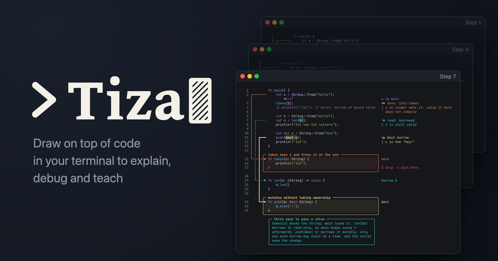
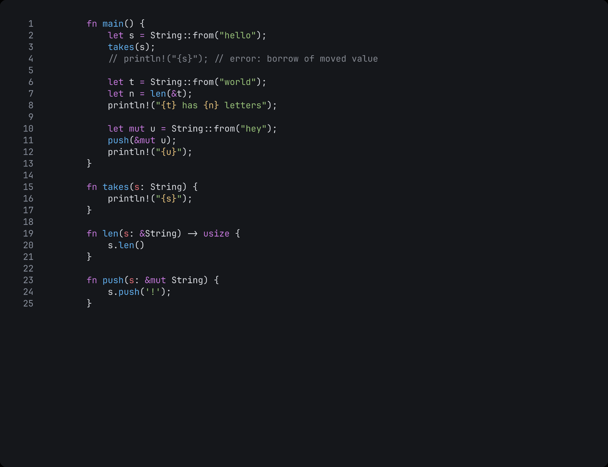
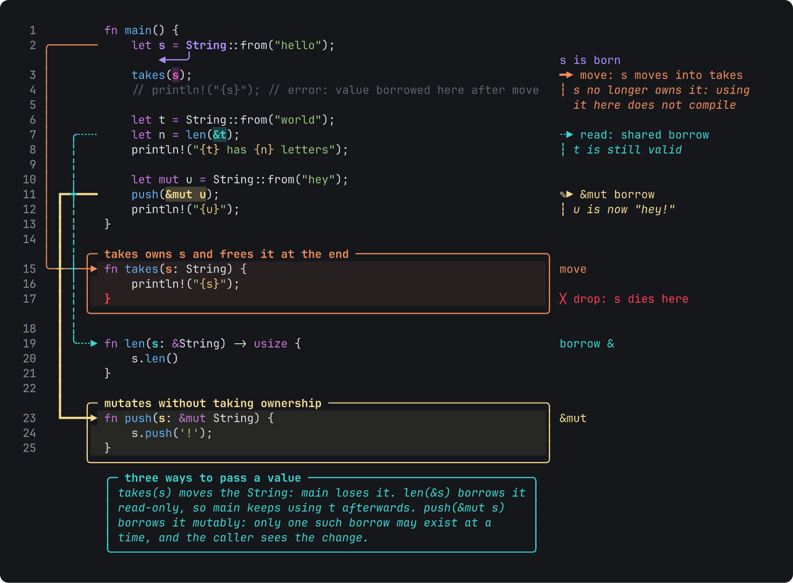

# ╭─ Tiza ─▶



**Draw on top of code in the terminal to explain it on video.**

Tiza is a Rust TUI (ratatui) built for tutorials: you share your screen with your editor, send the code to Tiza in a terminal and draw on top of it (boxes, arrows, highlights, notes and semantic marks such as *warn*, *read*, *write*, *move* or *drop*, plus any style you define, emoji included) to explain a concept step by step. Annotations are anchored to the code text, not to screen cells, so they survive scrolling, resizing and theme changes.

It is also **for agents**: it exposes a local socket API and an **MCP server**, so Claude Code (or any MCP client) can draw live on what you are showing.



> Status: **v0.0.1, first working demo**. Inspired by [Excalidraw](https://excalidraw.com), [excalidraw/cli](https://github.com/excalidraw/cli), [herdr](https://herdr.dev), [tuios](https://github.com/Gaurav-Gosain/tuios) and [Demo Time](https://demotime.show).

<!-- readme-images:ownership-txt -->
```
  1          fn main() {
  2 ╭───────     let s = String::from("hello");
    │                ◀───╯                                                      s is born
  3 │            takes(s);                                                      ━▶ move: s moves into takes
  4 │            // println!("{s}"); // error: value borrowed here after move   ┆ s no longer owns it:
  5 │                                                                             using it here does not
  6 │            let t = String::from("world");                                   compile
  7 │ ╭╌╌╌╌╌     let n = len(&t);                                               ╌▶ read: shared borrow
  8 │ ╎          println!("{t} has {n} letters");                               ┆ t is still valid
  9 │ ╎
 10 │ ╎          let mut u = String::from("hey");
 11 │ ╎ ┏━━━     push(&mut u);                                                  ✎▶ &mut borrow
 12 │ ╎ ┃        println!("{u}");                                               ┆ u is now "hey!"
 13 │ ╎ ┃    }
 14 │ ╎ ┃
    │ ╎ ┃ ╭─ takes owns s and frees it at the end ────────────────────────────╮
 15 ╰─╎─┃─┼▶ fn takes(s: String) {                                            │ move
 16   ╎ ┃ │      println!("{s}");                                             │
 17   ╎ ┃ │  }                                                                │ ╳ drop: s dies here
      ╎ ┃ ╰───────────────────────────────────────────────────────────────────╯
```
<!-- /readme-images:ownership-txt -->

## Installation

Binaries for macOS (Apple Silicon and Intel) and Linux in [Releases](https://github.com/luiscarlosjayk/tiza/releases). Download size: about 6 MB (tar.gz: 6.3 MB for Linux x86_64, 5.7 MB for macOS arm64; the binary inside is 11-13 MB), kept under 8 MB — and the binary under 16 MB — by `scripts/size-check.sh`. Windows: not supported in v0.x. Or from source (Rust ≥ 1.88):

```sh
cargo install --git https://github.com/luiscarlosjayk/tiza tiza
```

The release binaries are built with `scripts/release-local.sh vX.Y.Z` on a clean checkout of the tag: on macOS it builds arm64 and Intel (cross-compiled), on a Linux x86_64 machine or container the Linux x86_64 one, and it leaves in `dist/vX.Y.Z/` one tar.gz with its `.sha256` per target — the binary, README, licences and examples, as `release.yml` packs them — and `notes.md` with the commits since the previous tag, to attach to a release created by hand.

Inside a checkout, `rust-toolchain.toml` pins Rust 1.99.1 (with rustfmt and clippy) so local builds and the gate use the same toolchain; 1.88 stays the minimum supported version.

## Quick start

```sh
tiza src/main.rs            # open a file
tiza src/main.rs:12-48      # only a range of lines (numbering is preserved)
tiza src/main.rs --follow   # reload when the file is saved in the editor; annotations follow their text
pbpaste | tiza              # code from the clipboard (macOS); --lang rs when it cannot be guessed
tiza examples/ownership.rs.tiza --present   # open the demo in presentation mode
```

Try the bundled demos (see [examples/README.md](examples/README.md)): `tiza examples/ownership.rs.tiza` starts with the bare code; advance with `n`.

### Keys

| Key | Action |
|---|---|
| `j`/`k`, `↑`/`↓`, `g`/`G` | move the line cursor |
| `h`/`l`, `w`/`b`/`e`, `0`/`$` | move the column cursor (word motions) |
| `v` / `V` / `i` | select text / select lines / select the word under the cursor |
| with a selection: `h` `m` `n` `C` `b` `a` `s` | highlight (text selection; a line selection makes a focus) · mark (then type `KIND [label]`) · note · callout (then type the text) · box · arrow (source `a`, target `a`) · spotlight |
| `Tab` / `Shift-Tab` | select an annotation; then `Enter` edit label · `e` set properties · `x` delete · `c` color · `+`/`-` move step |
| `n` / `p` (or `→`/`←`) | next / previous step; step 0 shows only the code (with `"loop": true`, `n` past the last step is step 0 again) |
| `u` / `U` | undo / redo (the message names what was undone) |
| `t` | dark ⇄ light theme (like Excalidraw); fixes it in the document and stops following the terminal |
| `P` | presentation mode (hides the UI; one geometry for the whole take — see `:layout`). `:` still works there: the command line shows on the last row while you type, its result (or error) stays for ~2 s, then the frame is clean again |
| `f` | live pointer, like a laser pointer: the cursor line (or the `v`/`V` selection) stays as it is and the rest of the code dims, as with a spotlight; it follows `j`/`k` and every motion (in presentation mode too, where the cursor stays hidden), stays on its line across `n`/`p`, and `f` again or `Esc` turns it off. Nothing is created: it is never saved, never in the undo stack and never in an export, a GIF or a recording. An agent can point with the same pointer (`point_at`) |
| `L` | annotation list · `?` help · `:` commands · `q` quit (`:q!` quits without saving, also over stale moves) |
| `Ctrl-C` | cancels, or quits, as in vim: where something is open it closes it like `Esc` — the command line (its text is dropped, never run), a `v`/`V` selection, an arrow being drawn, the help, the list or the review — and with nothing open it quits as `:q!` (see **Saving**: it writes nothing the mode had not written already, a failed autosave is tried once more, and stderr says what was not saved). In normal and presentation mode, with the live pointer on, while a step types, with an annotation selected with `Tab` or a notice on the bar, it quits |

### `:` commands

`L` is a line number and `text` an exact fragment to find on that line (`.` is the cursor line).

```
:mark warn 3:s careful here           built-in kinds: info warn error ok question important read write move new drop scope flow todo
:mark 🔥 4:res.json hot path          one-off mark: any glyph/emoji + your legend
:style io glyph=⇄ legend="network I/O" color=cyan   reusable style, then :mark io 2:fetch
:arrow 2:s 15:s: String move          arrow between two points, with a label
:arrow 7:&t 19:s borrow stroke=dashed  arrow styles: stroke=solid|dashed|dotted|thick|double  route=rounded|sharp  heads=START,END (none arrow dot bar open)
:set a2 stroke=thick end=bar          change properties of an annotation (label, color, step; arrows: stroke, route, heads, start, end; boxes/callouts: border, corners, fill)
:box 15-17 takes owns s               box around a range of lines
:box @'// begin'..@'// end' label      range by two text markers (also :callout, :spot); quotes optional without spaces
:box 15-17 takes border=double corners=sharp fill=no   borders: border=solid|dashed|dotted|thick|double  corners=rounded|sharp  fill=yes|no (callouts take the same keys)
:hl 7:&t shared borrow                highlight (L:text must be on line L — a miss says where the text is; L: alone is the whole line)
:hl 7:&t shared emphasis=underline      how the span is drawn: fill (tint, default) · underline (a thin ‾ row under it) · brackets (⌈ ⌉) · strike — the glyphs are drawn in a softened shade of the annotation's colour, so the code reads first
:note 4 s no longer owns it           note anchored to a line
:callout 15-25 @auto title="why" two or three sentences…   bordered paragraph; @margin (default) | @below | @auto
:step 2        :step a3 2             change step · move annotation a3 to step 2
:goto borrow   :goto 3                 jump to a named step (`steps` in the .tiza) or a step number, as if walked there from step 0
:del a1        :clear | :clear 2       delete one · clear everything or only one step (u undoes)
:label a2 new text                     change the label
:color a2 blue   :color a3 #ff8800   color per annotation (orange blue green purple pink cyan yellow red gray · auto)
:spot 15-17 a2 a3   :spot a6 a7      spotlight: in this step everything but those lines/annotations is dimmed
:until s1 4                            spotlight s1 stays active until step 4
:focus 15-17   :focus                 dim everything but a range · clear the focus
:layout stable | :layout dynamic       rehearse with the take's geometry (`⊞ stable` on the bar) · let the authoring screen grow as steps add arrows
:theme light | dark | terminal | auto   :theme file PATH   theme (see «Themes»); `:theme` alone toggles
:lang ts | :lang auto   :pad 1 4   :w   :q      (:pad = blank margins, saved in the document; :pad 0 0 none, :pad default)
:margin 24 | :margin auto | :margin     cap the right margin at N cells (12-200) so long notes wrap earlier on a wide terminal; saved as `margin`; `render --margin-cols N` overrides it once
:numbers off | :numbers on | :numbers   hide or show the line-number gutter (saved in the document as `numbers`; exports and agents follow it; `render --no-numbers` / `--numbers` override it once)
:follow on | :follow off | :follow        reload the code when the source file is saved · state
:autosave off | :autosave on | :autosave  stop writing the sidecar on every change (`--no-save` at start) · resume (writes what is pending) · state
:export shot.txt | :export shot.md | :export shot.png [step=N] [width=N] [theme=light]   export what a step shows (.txt .ansi .md .svg .png)
:supervise on | :supervise off | :review   agent changes wait for your y/n (a = all, d = none); 60 s without a decision = rejected
:mouse on | :mouse off                     click moves the cursor, drag selects (then h/b/a/n…), wheel scrolls; off by default
```

The language is detected from the file extension, then well-known names (`Makefile`, `Dockerfile`, `Cargo.lock`, `.bashrc`…), then a `#!` line, then a Vim/Emacs modeline in the first or last five lines; pasted or piped code uses the same shebang/modeline rule. `--lang` and `:lang <id>` override it (saved in the document); `:lang auto` re-detects and says how; an id without a grammar is shown as plain text with a warning.

New annotations appear at the current step. The `.tiza` references the source file by path (`"code": {"file": "main.rs", "lines": "12-48"}`, absolute or relative to the `.tiza`), so it always shows the current code; `:embed` freezes a copy inside the document (and a copy of every file the demo links to) and `:ref path[:A-B]` references a file again (`:link` does the same at step 0; at a step ≥ 1 it is the *move* below). Color is yours, as in Excalidraw: every annotation accepts `color` (a name or `#rrggbb`); arrows without a color rotate through a palette so they can be told apart. Arrow strokes and heads are yours too: dashed for a shared borrow, thick for a move, `heads=none,none` for a plain connector — the ownership example does exactly that. Everything is saved automatically to a `.tiza` (JSON) next to the source file (`src/main.rs.tiza`).

**Follow mode** (`--follow` or `:follow on`) watches the source file's folder (Zed saves with a temp file + rename) and reloads the code about 120 ms after the last write, so you can edit in the editor while the TUI shows the result. Annotations are re-anchored by the text they point at, like a paste: a line diff matches the two versions in order (so a note on the second `}` stays on the second `}`), then the same occurrence of the span inside the line; a block moved elsewhere is followed when its line is unique and within 50 lines (a callout on it travels with it), a box, callout or spotlight whose edge line you edited or moved away keeps its height from the edge that stayed (it never stretches), a line you rewrote in place keeps its note and the spans whose text is still there (also when several adjacent lines are rewritten together, like a parameter renamed on the signature and on the line that uses it: the lines pair up one to one), a formatter that splits or joins a line (rustfmt) carries the span to the line that now holds its text, and the ones whose text is gone are dropped with a message — never moved to another copy — and `u` undoes the whole reload. A reload that changes no annotation leaves no undo step, so after an editor undo one `u` brings the dropped annotations back; the message after `u` names what it undid (`undone: reload #54`, `undone: note a3`, `undone: 3 annotations cleared`). The status line shows `⟳ following · last HH:MM:SSZ`; a removed file shows `waiting` until it comes back, an empty intermediate write is skipped, and embedded documents have nothing to follow (`:link path` first). A paste while following turns follow off too and says so (`follow off: the code is pasted, not main.rs; :follow on reloads main.rs`): the pasted code is yours, so a save in the editor no longer replaces it; `:follow on` loads the file over it as one reload `u` undoes (a paste of exactly what the file holds keeps following); `u` back to the file says `follow is off: :follow on reloads main.rs`. An undo or a redo that brings back code the file no longer holds (one from before a reload, or from before a save in the editor) turns follow off the same way (`follow off: the code on screen is not main.rs; :follow on reloads main.rs`) and the `.tiza` keeps that code embedded, as after a paste, until `:follow on` reloads the file. `:link` or `:ref` at step 0 over pasted or embedded code loads the file's code the same way, so the screen always shows what the saved `.tiza` will. A save in the editor while moves are applied (step 1 or later) waits for step 0 (`main.rs changed on disk but moves are applied at step 2: go back to step 0 to reload`); meanwhile the `.tiza` keeps the code on screen embedded, so quitting there leaves a file that opens as it was shown, and back at step 0 the change is reloaded at once, as one reload `u` undoes (a file saved back as it was is no reload). `--follow` or `:follow on` at such a step (a `.tiza` with moves and no `step` opens at its last one) turns follow on in that wait: `following main.rs (waiting: moves applied at step 1; loads at step 0)`. `:embed` while following turns follow off and says so: the code is frozen inside the `.tiza`, so later saves in the editor no longer reach the screen until `:link` and `:follow on`. Agents get the same through `follow.set` / `follow.status` and the MCP tool `set_follow`.

**Saving** — every change is written to the `.tiza` sidecar as it happens (an atomic replace next to the source). Three things turn that off: `tiza FILE --no-save` (annotate an example or a demo without touching the file on disk — the bar shows `no-save`, then `unsaved (:w)` once something changed), `:autosave off` live (`:autosave on` resumes and writes what is pending; `:autosave` alone shows the state, and `status` carries `autosave`), and a `scene put` of a document from another source, or with code that differs from the file it reads (the agent's document is shown, but the file that was open is never overwritten by it; the message says so). After a `scene get` → `scene put` of the open document, a sidecar that reads its code from a file still does (nothing gets embedded), and a put that changes nothing writes nothing. With autosave off, `:w` saves to the open file on purpose, `:w PATH` saves elsewhere, and `:q` refuses while there are unsaved changes (`:q!` quits without saving). A sidecar that cannot be written (a read-only file or folder — the atomic replace honours the file's read-only bit instead of walking over it) is the same state as `:autosave off`, one rule for all four cases: the first failed autosave says `read-only: could not save FILE — :w PATH to save elsewhere` once, then the message line is yours again (each command's own confirmation shows) and the bar keeps `read-only • unsaved (:w)` until a save works; `:q` refuses while there are unsaved changes (`unsaved (read-only): :q! quits without saving, :w PATH saves elsewhere`); if the file becomes writable again, the next autosave succeeds, says `saved to FILE` once and the indicator goes away. `render`, `scene get`, the exports and `--smoke` never write. **No way out writes anything the chosen mode would not have written already**: with autosave on every change is on disk the moment it is made, so quitting writes nothing more, and what could not be saved (a read-only file that became writable again) is retried once on the way out with Ctrl-C — never with `:q!`; with autosave off (or a read-only file) `:q!` and Ctrl-C quit without saving and print on stderr what was not saved (`tiza: quit without saving main.rs.tiza: 1 change not saved (note a1)`). `:q` refuses while changes are unsaved and `:wq` saves first. A terminal that goes away under Tiza (a pane or a tab closed, an SSH session dropped) quits it as Ctrl-C does; what it would have printed goes to `panics.log` in Tiza's runtime directory (`$XDG_RUNTIME_DIR/tiza/`, else `$TMPDIR/tiza/` or `/tmp/tiza/`), since there is no terminal left to print it on.

**Moves** (the code changes between steps, [ADR 0007](docs/adr/0007-moves-y-pasos-con-nombre.md)): a `.tiza` may carry `moves`, each a `code.patch` that inserts, replaces or deletes whole lines when the presenter reaches `at_step` — `n` applies it, `p` reverts it, and the document is always recomputed from the step-0 code, so going back and forth ten times leaves it exactly as it started. A target is matched on the code as shown at that step and must match exactly once (`after`/`before` a line's text or `position` for an insert; `find`, `find_start`/`find_end` or `position: "7-9"` for a replace or delete) — or say which match with `"occurrence": N`, 1-based and counted in reading order over the whole code at that step (`end_occurrence` for `find_end`). With `"typing": "line"` or `"char"` the content is typed in place (`speed_ms` per line or character; any key finishes it and is consumed — an `n` pressed mid-typing completes the step instead of advancing, so press it again; the step's annotations appear when the typing ends). Annotations are authored against the code at their own step and shifted through later patches by the patch itself — an insert or delete moves the lines after it, a box that loses an edge line shrinks — never by a text search. On a line a `replace` overwrites, a note, box, callout or spotlight keeps the line at the same offset, but a highlight, mark or arrow end has nothing under its columns any more and is hidden as `(unanchored)` in `:list` (never deleted) unless the move's `rebind` says where it goes (`"rebind": {"a4": {"at": {"find": "t.len()", "occurrence": 1}}}`, resolved on the code after the patch); the same happens to any annotation that loses every line. Adding or deleting a move later carries what comes after it — the annotations of its file at its step and later, and the line numbers of later moves — so they stay on the same text, and deleting a move gives back the document from before it; a move that would lose something on the way (the line an annotation is on, a range's first or last line, a later move's target) is refused, naming it. `tiza examples/ownership-moves.rs.tiza` shows a helper being typed in and later replaced by a method call; `render --step N`, `.cast` and `.tape` apply the moves instantly (`render --step N` past the last step warns on stderr and shows the last one; a `.tape` holds a typed step for the typing time plus half a second). A paste is refused while a move is applied (step back to 0 first), and a save in the editor waits for step 0 (follow mode, above); at step 0 a paste re-applies the moves on the new text and re-anchors every annotation on the code at its own step, so a step-3 arrow onto a line a move typed in survives; `:embed` and the saved file always keep the step-0 code.

**Several files, each with its own annotations** (t-105): a `code.link` move shows another file from its step on — `{"at_step": 2, "action": "code.link", "file": "src/queue.rs", "lines": "10-36"}`, or `:link src/queue.rs:10-36` typed at step 2 (at step 0 `:link` is the one-shot reference above; `:ref` always is). Each file is a *view*: the annotations you add while it is shown belong to it (they get a `"file"`; absent = the document's own file), their lines are the file's real line numbers, and `lines` is only a window that crops what is on screen — a note outside the window is kept and simply not drawn, the same file with another window is the same view, and linking the document's own file again brings its annotations back exactly as they were. `:list` names the file of every annotation of a linked file (`a4 [step 3] box L15-17 (src/queue.rs)`), the bar shows `↪ src/queue.rs:10-36` while a link is up, a `code.patch` edits the file shown at its step, and `:embed` stores every linked file under `views` so the demo stays one portable `.tiza` (a link to a file that cannot be read fails to load naming the move and the path). Three more moves go with it: `cursor {line, col}` puts the cursor on a line, `select {from, to}` highlights a span (each end a `find` that must match exactly once at that step, or `line`/`col`) and `wait {ms}` pauses before the step's annotations appear (the TUI, the GIF and the tape honour it; a still render ignores it). `n` applies them, `p` reverts them, `render --step N` and the exports draw the cursor and the selection at once. `tiza examples/stack-and-queue.tiza --no-save` walks a stack and a queue, back and forth, each with its own boxes and notes.

**Named steps, auto-advance and loop** (t-099, [ADR 0007](docs/adr/0007-moves-y-pasos-con-nombre.md) §4): automation for unattended recordings, a looping booth screen or an editor task that advances the demo — not speaker tooling (no notes, no timer, no clicker features). A `.tiza` may carry `"steps": [{"step": 3, "id": "borrow", "title": "Shared borrow", "auto_advance_ms": 3000}]`: each entry names its step by number (never by its place in the list, so moving an annotation to another step with `+`/`-` shifts nothing), entries may be sparse and are saved sorted by `step`, ids are unique, one word, not all digits (a number always means a step number) and do not start with `-` (`tiza goto -1` would read it as an option). The status line shows `step 3/7 · Shared borrow` (the id when there is no title; presentation mode has no bar, so nothing new appears in a take), `status` reports `step_id`, `step_title` and `step_label`. `:goto borrow`, the socket's `step.goto {"id": "borrow"}`, the MCP's `goto_step` and **`tiza goto borrow`** jump there exactly as `n` would after walking from step 0 — moves and linked files recomputed, a typed step landed with its text complete — and an unknown id is `not_found`. `tiza next` and `tiza prev` step the running instance, with no JSON to quote (the session's socket, or `--socket`/`--session` like `tiza api`); they print the step reached and exit non-zero with `no Tiza instance is listening…` when nothing runs. With `auto_advance_ms` the TUI moves to the next step on its own that long after the step is ready: a typed move finishes typing and a `wait` elapses first, a key meanwhile only finishes the typing, and an open `:` line, `v`/`V` selection or overlay holds the countdown until it closes. `"loop": true` makes `n` (and an auto-advance) past the last step go back to step 0. An entry for a step past the last one, and a key an entry has that Tiza does not know (a typo, the dropped `timer_min`), is kept in the file and warned about (on open, in `status.warnings`, by `render` and `tiza check`), never dropped.

## Export to text, Markdown, ANSI, SVG, PNG, GIF, MP4, asciicast or VHS

```sh
tiza render demo.tiza --out thumb.png --step 3          # PNG at 2× (thumbnails, posts)
tiza render demo.tiza --out figure.svg --theme light     # SVG with the fonts embedded
tiza render --out shot.png                                   # what the live instance shows right now (linked files included)
tiza render demo.tiza --out notes.md --step 2            # fenced code block for a README, an issue or a chat
tiza render demo.tiza --out - --format ansi | less -R    # 24-bit ANSI, no trailing spaces
tiza render demo.tiza --out demo.gif                     # animated GIF of every step, drawn by Tiza (nothing to install)
tiza render demo.tiza --out demo.mp4 --interval 3        # MP4 through the ffmpeg on your PATH (never bundled)
tiza render demo.tiza --out demo.cast                    # asciicast v3 of every step (asciinema, agg)
tiza render demo.tiza --out demo.tape && vhs demo.tape   # VHS tape → demo.gif, for the terminal-window look
tiza render demo.tiza --all-steps --out steps/           # steps/step-00.png … step-NN.png, one per step, all the same size
```

`--all-steps` writes one still per step, step 0 included (`--skip-zero` starts at step 1), into a directory (`--format svg`, `txt`, `ansi` or `md` for the others; `--out -` is refused): every image has the take's stable geometry and is padded to the same pixel size, so they line up in a video editor or a slide deck. Re-running it into the same directory removes the `step-NN` files of the same format an earlier run left beyond the last step (and names them). Only names this run writes count: `step-` + the same number of digits (the last step's, at least two) + `.` + the format, lowercase, a regular file; `step-1.png`, `STEP-05.PNG`, `step-05.png.bak`, `step-0123.png` next to a 7-step take, a directory or a symlink are yours and stay (a directory or symlink named like a step is named), so a `step-%02d.png` glob never picks up a stale frame; files of another format are left alone and named.

**Stable geometry.** A take is one layout, not seven: in presentation mode and in every export (`render --step N` for each step, `.gif`, `.mp4`, `.cast`, `.tape`) the arrow lanes, the box band, the code column and the right margin are sized once for the maximum over every step of the document, so the code never slides sideways when a later step adds an arrow and a label that fits at step 1 still has its margin at step 7 (each arrow also keeps its lane for the whole take). The authoring screen grows as you go by default; `:layout stable` rehearses with the take's geometry (`⊞ stable` on the status line) and `:layout dynamic` goes back.

**Recording every step.** Four outputs turn the whole take into an animation, every one drawn from the same frames as the PNG export (one geometry for the take), so nothing slides between steps and nothing shows that the screen does not:

- `--out demo.gif` — an animated GIF written by Tiza itself, nothing to install: one frame per step from 0 (`--skip-zero` starts at the first annotated step), `--interval` seconds each (2; the last one twice as long so a loop does not cut the end short) — except a named step with `auto_advance_ms`, which stays exactly that long, after its typed frames, so the document's own timing drives the animation (t-099; the summary line names those steps, and MP4/WebM use the same durations), the typed frames of `code.patch` moves at their `speed_ms` (the format counts in 10 ms units and players treat anything under 20 ms as 100 ms, so faster typing is rounded up to 20 ms), looping forever (`--loop N` plays it N times), `--scale` 2 by default as for a PNG (long italic notes are soft at 1; `--scale 1` halves each side and the file), one palette per animation (the colours that cover most pixels — background, code, rails — kept exactly, the anti-aliasing blends reduced into the rest of the 256, no dithering so text stays crisp) and every frame after the first stored as the rectangle that changed: the seven-step `examples/ownership.rs.tiza` is ~395 kB at 100 columns (2048×1650 px; ~170 kB with `--scale 1`). The summary line says frames, size, seconds per loop and colours.
- `--out demo.mp4` (or `.webm`) — the same frames muxed by **`ffmpeg` from your PATH** (or `$TIZA_FFMPEG`): Tiza writes them to a temporary folder with their durations and runs a fixed command it prints first (30 fps, even dimensions, `yuv420p` H.264 for MP4 and `yuv420p` VP9 for WebM, each frame timed as in the GIF — 10 ms unit, 20 ms floor — and cut with `-t` at the sum, so the video lasts exactly what the GIF does on every ffmpeg version, t-170), then removes the folder. ffmpeg is never bundled, downloaded or vendored, not even behind a feature flag ([ADR 0009](docs/adr/0009-politica-de-red.md) spirit: the binary that shows your code stays what it is); without it the command exits with code 2, says how to install it (`brew install ffmpeg`, `apt install ffmpeg`…) and reminds you that `.gif` and `.cast` need nothing. No half-written file is ever left behind (temp + rename).
- `--out demo.cast` — an [asciicast v3](https://docs.asciinema.org/manual/asciicast/v3/) of every step as text (tiny; play it with `asciinema play demo.cast`, embed it with the asciinema web player, or turn it into a GIF with [agg](https://github.com/asciinema/agg)).
- `--out demo.tape` — a [VHS](https://github.com/charmbracelet/vhs) tape that runs the real TUI in presentation mode and presses `n` through the steps, for the VHS look (a terminal window with its chrome): `vhs demo.tape` needs `vhs`, `ttyd` and `ffmpeg` and produces `demo.gif`. A step with `auto_advance_ms` moves on by itself in the real TUI, so the tape holds it for its typing plus that time and sends no `n` after it. The tape sizes the window for the TUI at the given width (12 px per column and two spare rows at `FontSize 18`, plus the padding), colours it with the document theme (`--theme light` for a light window), quotes every path and holds a typed step for the typing time plus half a second.

All four start at step 0 (code only) unless `--skip-zero`, honour `--interval`, and after writing, the CLI says how to play the file.

The text formats keep the box-drawing characters as they are on screen (`.txt`: plain, no trailing spaces or blank rows; `.md`: the same inside a ```` ```text ```` block with the document title above; `.ansi`: 24-bit colors with a reset per line, for `cat`, `less -R` or a terminal-recording tool). Inside the TUI, `:export shot.md` (or `.txt`, `.ansi`, `.svg`, `.png`, with `step=`, `width=`, `theme=`) writes the same next to the document.

Options: `--width` (columns, default 100 or the live terminal's), `--font-size` (16 px), `--margin` (1.5 cells), `--radius` (12 px, `0` for square corners), `--scale` (PNG and GIF 2, MP4/WebM 1), `--no-embed-fonts` (small SVG that uses the viewer's fonts; by default the SVG embeds only the faces it draws — regular always, bold, italic and the symbols fallback when used), `--system-fonts` (PNG fallback for emoji/CJK). The fonts ship inside the binary — JetBrains Mono (OFL, the four faces complete) for everything, code and notes alike, and a symbols subset of DejaVu Sans Mono — so the output is identical on every machine. Agents get the same through the `export_image` MCP tool (which also writes `.txt`, `.ansi` and `.md`).



Every image in this README is made by Tiza itself, with no screen recording: `scripts/readme-images.sh` renders the GIF at the top (the native `.gif` export), this step-7 PNG, the text block under the GIF and the three real `--step` frames of the hero image (`docs/img/src/hero.html`, screenshotted by a headless Chrome or Chromium — a docs-only tool, skipped with a message when none is installed), all from `examples/ownership.rs.tiza` at `--width 108`. Running it twice gives the same bytes.

## For agents: MCP and local API

With the TUI open, start the MCP server in another process:

```sh
tiza mcp
```

Configuration for Claude Code (the project's `.mcp.json` or `claude mcp add tiza -- tiza mcp`; if you had the server registered under the old name `codedraw`, remove it, add `tiza` and reconnect with `/mcp`):

```json
{ "mcpServers": { "tiza": { "command": "tiza", "args": ["mcp"] } } }
```

Tools: `status`, `check` (the `tiza check --json` preflight of the live document; run it before showing one), `get_code`, `list_annotations`, `add_mark`, `define_style`, `list_kinds`, `add_arrow`, `add_box`, `add_note`, `add_callout`, `highlight`, `add_spotlight`, `update_annotation`, `delete_annotation`, `clear_annotations`, `add_move`, `delete_move`, `list_moves`, `set_step`, `next_step`, `prev_step`, `goto_step`, `set_focus`, `point_at`, `clear_pointer`, `set_theme`, `set_follow`, `render_text`, `export_image`. Anchors accept `{"find": "takes(s)"}` in addition to line and column, because an agent rarely knows the exact column; boxes, callouts and spotlights also take `find_start`/`find_end` (two texts that delimit the range, like Demo Time placeholders) instead of line numbers; `update_annotation` moves an existing annotation with the same anchors, keeping its kind and style. The server also publishes four MCP resources a client can attach as context without a tool call: `tiza://scene` (the document as JSON), `tiza://code` (numbered code), `tiza://render` (the current frame as text) and `tiza://render.md` (the frame in a Markdown fence). Full guide: [docs/agent-guide.md](docs/agent-guide.md). Ideas for what to show with an agent — a codebase tour, one agent explaining code to another, a review, a bug hunt — with a runnable tour of a four-file codebase: [docs/demos/scenarios.md](docs/demos/scenarios.md).

**Mouse** (`--mouse`, `:mouse on|off`): off by default, because capturing the mouse takes the terminal's own text selection away; while it is on, a click moves the cursor, a drag selects a span (one line) or a range of lines and leaves the selection open for `h` (highlight), `b` (box), `a` (arrow end), `n` (note), `C` (callout), and the wheel scrolls. It is for live, spontaneous explanations in normal mode, where the status bar shows what you select; presentation mode (`P`) ignores clicks, drags and the wheel (the cursor and the selection are hidden there, so a mouse selection would be blind) — to annotate with the mouse, leave presentation mode first. To copy text from the terminal while Tiza captures the mouse, hold Shift while dragging (Ghostty, WezTerm, most Linux terminals) or Option (iTerm2, Terminal.app); Zed keeps Cmd+click for links even with mouse reporting on; under tmux the mouse reaches Tiza only with `set -g mouse on`.

**Supervised mode** (`:supervise on`, socket `supervise.set`): while you present, every change an agent asks for is parked as a proposal — the review overlay lists them (`▶ p1  add note L4 «…»`), the status bar shows `⏸ N to review (y/n)`, and the agent's call only returns once you press `y` (applied, normal result) or `n` (error `rejected`); `a`/`d` decide everything at once, Esc hides the list and `:review` brings it back, and a proposal nobody decides within 60 s is rejected. While the list is open, Enter accepts the first proposal; `:` hides it and opens the command line, so typing a command from the list is safe. In presentation mode the list does not pop up: a chip `⏸ N to review` shows bottom-left instead, and the list opens by itself when you leave presentation mode (`P`) with proposals pending. Reads (`status`, `get_code`, `render_text`, the resources) never wait.

**What an agent adds where you cannot see it**: when an agent (socket or MCP) adds or changes an annotation the view does not show — a later step, a file a `code.link` hides, lines outside the window — the status bar says so the way your own commands do, with ` by agent`: `a17: box 3-5 added by agent (step 1, press n)`, `a4: note L13 updated by agent (step 3, :step 3 shows it)`, `a9: note L17 added by agent (src/queue.rs, not shown at step 2)`. Several within a second share one message (`3 agent annotations not shown (step 1, press n)`); in supervised mode the acceptance carries the tail (`accepted p1: add box L3-5 (step 1, press n)`). Presentation mode never draws it on the take: it reaches the bar when you leave (`P` or Esc), leaving out what you have reached meanwhile.

**After rebuilding Tiza** (`git pull && cargo build`, `cargo install`): an MCP client reads the tool list once per connection and keeps talking to the `tiza mcp` process it started, which is still the old binary. New or changed tools appear only after the client reconnects — in Claude Code: `/mcp` → `tiza` → *Reconnect* (or restart the session). The `status` tool says when this is needed: its `bridge` object carries the server's `version` and `build` (git commit, also in `tiza --version`) and sets `binary_rebuilt: true` with a hint once the binary on disk is newer than the running server, or `instance_build` when the TUI was built from another commit (restart the TUI too). `notifications/tools/list_changed` would not help here: the stale process cannot know the new one's tools.

The contract is published as JSON Schema: [`schema/tiza.schema.json`](schema/tiza.schema.json) (the document) and [`schema/api.schema.json`](schema/api.schema.json) (every socket method, params and result), regenerated with `tiza schema document|api` and checked in CI; the live instance also answers `api.schema`. `-` means stdin everywhere: `cat demo.tiza | tiza render - --out -`, `pbpaste | tiza render - --lang rs --out shot.png`, `tiza api annotation.add -`.

The same API is available as a Unix socket with line-delimited JSON (design borrowed from herdr) and from the CLI:

```sh
tiza scene status                 # is there an instance? what is it showing?
tiza scene list                   # annotations
tiza scene text                   # what is on screen, as text
tiza api annotation.add '{"type":"note","line":4,"text":"hello"}'
tiza scene put other.tiza      # replace the live document (u undoes, step included); also takes a `scene get` envelope; a plain file only with --as-code
tiza scene patch '{"step":2,"theme":"light","annotations":[{"id":"a1","deleted":true}]}'   # partial change, merged by id
tiza api move.add '{"at_step":2,"action":"code.patch","op":"insert","after":"let b = 2;","content":"    let c = 3;","typing":"line"}'   # the code changes at step 2
tiza render demo.tiza --out - --step 2 --width 100   # without opening the TUI
tiza check demo.tiza --json        # preflight of a file: errors, warnings, the narrowest clean width
```

Several instances: `--session name` (or `TIZA_SESSION`). Explicit socket: `--socket path` (or `TIZA_SOCKET`). The socket lives in `$XDG_RUNTIME_DIR` or `$TMPDIR` with 0600 permissions and **never** listens on TCP.

## What Tiza reads and writes

**The `tiza` binary that shows your code has no network dependencies and never opens a connection.** Its only I/O is your terminal, the files you name, the `.tiza` sidecar next to them, and a local Unix socket for agents (never TCP). Features that talk to the internet live in a separate crate and binary, are off unless you run them, and state what they send before they send it ([ADR 0009](docs/adr/0009-politica-de-red.md)).

In detail, `tiza` reads the source file you open (and re-reads it in follow mode), the `.tiza` document, the files a `.tiza` references, and what agents send over the socket; it writes the `.tiza` sidecar (every change, unless `--no-save` / `:autosave off`), the exports you ask for (`:export`, `render`, `export_image`) and the socket itself. It never reads your shell history, your editor's configuration, environment variables other than `TIZA_*`, `TMPDIR` and `XDG_RUNTIME_DIR`, or any file you did not name. There is no telemetry, no crash reporting, no update check and no identifier of any kind; `Cargo.lock` has no HTTP or TLS crate, and `cargo-deny` keeps it that way (`deny.toml`). When a network feature exists it will be a separate `tiza-net` binary that runs only on your command (`tiza-net publish demo.gif`, `tiza-net update-check`), prints what it is about to send, never includes your code or annotations unless sending them is the point and you asked.

## Zed integration

A task that sends the current selection to Tiza in the integrated terminal: [docs/zed.md](docs/zed.md).

## Terminal support

**Verified on macOS in Zed's integrated terminal and in [Herdr](https://herdr.dev)**, the terminals Tiza is built and used in. Any terminal with truecolor (24-bit colour) and Unicode box drawing should work; the others (Ghostty, WezTerm, iTerm2, Kitty, Alacritty, Terminal.app, tmux, Linux terminals) are **not tested** — reports welcome.

What Tiza asks of the terminal, and what happens without it:

- **Truecolor.** The `dark` and `light` themes are explicit RGB colours. Tiza does not read `COLORTERM` and has no 256-colour fallback, so in a terminal without 24-bit colour they come out wrong. `--theme terminal` (`:theme terminal`) draws Tiza's roles and the syntax with the terminal's own 16 ANSI colours instead (a colour you set yourself as `#rrggbb` is still sent as 24-bit).
- **Unicode box drawing** (`─ │ ╭ ╯ ┆ ━ ▶`) in a monospace font whose box glyphs fill the cell, so lines join without gaps. Emoji in your own styles need a font that has them.
- **Bracketed paste.** Tiza turns it on: pasting code into the window replaces the code shown (into the `:` line, it pastes the first line). A terminal without bracketed paste delivers a paste as typed keys, which Tiza runs as commands — pipe the code in instead (`pbpaste | tiza`).
- **Mouse, only if you ask.** Without `--mouse` / `:mouse on` Tiza never requests mouse reporting and the terminal keeps its own selection; with it, see **Mouse** above.
- **The OSC 11 / OSC 10 colour query** (auto appearance, see [Themes](#themes)): sent at start and on every resize, only when the document names no theme or with `--theme terminal`; Tiza waits 100 ms at most and falls back to dark in silence when nothing answers.
- **Plain keys.** Tiza does not enable the kitty keyboard protocol and no shortcut depends on it (`Shift-Tab` is the classic back-tab every terminal sends).

Known caveats (not tested here):

- **Terminal.app** has 24-bit colour only since macOS 26; on older macOS use `--theme terminal` or another terminal.
- **tmux.** What happens to the colour query depends on the tmux version (checked in Docker on Linux, under a light outer terminal): **tmux 3.5a** asks the outer terminal itself and answers Tiza's query with its colours, so auto appearance works with no configuration; **tmux 3.3a** neither lets the query out nor answers it, so Tiza stays dark — pick the theme by hand there (`--theme light`, `t`) or upgrade tmux. Versions between 3.3a and 3.5a are not tested. Tiza sends the query as plain OSC, not wrapped for tmux's passthrough, so `set -g allow-passthrough on` changes neither case. tmux does not resize when the outer terminal changes theme, so `kill -WINCH $(pgrep tiza)` asks again. tmux's own `set -g mouse on|off` decides, together with Tiza's `--mouse`, who gets clicks, drags and the wheel. tmux passes 24-bit colour through only when it knows the outer terminal has it (`set -as terminal-features ',*:RGB'`).
- **Zed** needs `line_height: "standard"` in the terminal settings for box drawing without gaps ([docs/zed.md](docs/zed.md)).

A terminal issue? [Open an issue](https://github.com/luiscarlosjayk/tiza/issues) with the terminal's name and version, the output of `echo "$TERM $COLORTERM"`, whether tmux or Herdr sits in between, and a screenshot.

## Themes

Tiza ships two palettes, `dark` and `light`, with explicit RGB colours measured for 1080p video (every text colour keeps ≥ 4.5:1 against the background after YouTube-like compression — `scripts/legibility.py`, the t-072 gate). Around them:

- **Auto appearance.** A document that names no theme follows the terminal: on start Tiza asks the terminal for its background (OSC 11, with OSC 10 for the text colour), decides light or dark by luminance (the 299/587/114 rule, threshold at half) and shows `dark·auto` / `light·auto` on the status line. The query waits 100 ms at most and falls back to dark in silence when nothing answers (a pipe, a CI pty, a multiplexer that swallows it). When the terminal changes its theme it usually sends a resize, and Tiza asks again on every resize — inside tmux or a terminal that does not resize on a theme change, `kill -WINCH $(pgrep tiza)` asks by hand. `t`, `:theme dark|light`, `--theme` or a document that names a theme fix it and stop following; `:theme auto` (or `--theme auto`) follows again and the document stops naming one. Mode 2031 (the terminal reporting its colour scheme on its own) is not enabled: the input library would read the report as key presses.
- **`:theme terminal`** (`--theme terminal`): Tiza draws with the terminal's own palette — default background and text, the roles on the 16 ANSI colours, syntax on the terminal's colours — so it looks like the rest of your terminal. Never the default. Exports have no host palette to paint with: `:export`, `tiza render` and `export_image` fall back to the dark or light theme (whichever matches the terminal's background) and say so.
- **Per-token overrides.** A `[theme]` table in `~/.config/tiza/config.toml` (or `$TIZA_CONFIG`, `$XDG_CONFIG_HOME/tiza/config.toml`) and the same keys in a document's `theme_overrides` replace any of Tiza's roles — `bg`, `fg`, `muted`, `dimmed`, `accent`, `rail`, `box_line`, `box_bg`, `arrow`, `note`, `highlight_bg`, `status_bg`, `status_fg`, `cmd_bg`, `error` — and the named annotation palette (`orange`, `blue`, `green`, `purple`, `pink`, `cyan`, `yellow`, `red`, `gray`). Values: `#rrggbb`, `#rgb`, `rgb(r, g, b)`, an ANSI name (`red`, `bright-blue`, `ansi208`) or `reset` (the terminal's own colour; exports fall back for it). `[theme.dark]` and `[theme.light]` subtables apply on top of the flat tokens when that base theme is active. Precedence: built-in → config file → document → `:theme` / `t`. Text tokens that end up under 4.5:1 on the background are pushed toward the text colour and `:theme` says which (`theme muted: #202020 reads at 1.3:1 … pushed to #8a8a8a`); the syntax colours of the base theme are lifted the same way at render time. Unknown keys are reported and ignored; a config file that does not parse is reported once and ignored.
- **Theme files.** `--theme-file PATH` and `:theme file PATH` load a TOML file with the same tokens (a `[theme]` table or bare keys) into the document's `theme_overrides`, so the next session and every export match; `tiza render --theme-file PATH` uses it for one export instead of the document's. The one shipped example is [`examples/themes/catppuccin-mocha.toml`](examples/themes/catppuccin-mocha.toml) — Catppuccin's published Mocha values on Tiza's roles, and THE example of how to write one; it passes the legibility gate (`python3 scripts/legibility.py examples/ownership.rs.tiza --step 7 --theme-file examples/themes/catppuccin-mocha.toml` → worst contrast 5.8:1 after compression). The base theme's syntax palette (One Half Dark/Light) is not a token: a theme file recolours Tiza's roles, not the code's keywords.

## Recommended recording profile

**Before you record**, run `tiza check demo.tiza`: it loads the document as the TUI does and lists every problem at once — an anchor, marker or move target that no longer matches (or matches twice) at its step, a linked file that cannot be read, an unknown or duplicate id (errors, exit 1) — and what would spoil the take: an annotation a move hides, one outside the `code.link` window of its own step or pushed out of it by a later patch, one of a file its own step does not show (said even when that file shows at other steps, since it is never drawn at its own), a label clipped with «…» at the width you record at (100 unless `--width N`), a step where nothing changes (warnings; `--strict` fails on them too). A marker (`find_start`/`find_end`) that matches more than once is a warning with the lines it is on (the range takes the first match). It ends with the narrowest width from which no label is clipped (`examples/ownership.rs.tiza` says 108: the width of the README images); below the width where notes move under their lines a narrower take can be clean again, and when you ask for one of those it says so (`--width 85`: `no label is clipped at 108 or wider; 79-93 are clean too (notes go under the lines below 94 columns)`). `--json` gives the same findings to a script; it writes nothing. A live instance answers the same report for the document it holds, unsaved changes included: `tiza api check '{"width": 108}'` (the MCP `check` tool).

Use demo values for tokens, passwords and credentials in anything you record: what is in the file is what the audience sees. Full-screen terminal or 50 % next to Zed, 18–22 px font, snippets of ≤ 60 columns. The status line shows `cols×rows` and a ⚠ badge when the terminal is under 100×30 or a code line is clipped (`status` over the socket lists the same `warnings`); below ~100 columns, notes are drawn under the line instead of in the margin (an arrow's label then sits on the arrowhead's row right after the code when it fits, or on the row below behind the arrow's own glyph — `─▶ move` — so it reads as the arrow's, never as a loose comment), and callouts with `placement: auto` move below their lines. One blank column is kept at each side by default (`:pad V H` to change it, `:pad 0 0` to remove it, `:pad default` to go back). Both themes use explicit RGB colors designed for 1080p and checked after YouTube-like compression (`scripts/legibility.py`, run in CI: every text color keeps ≥ 4.5:1 against the background). The terminal font is yours: the exports set everything — code, notes, labels and legends — in JetBrains Mono, so using it in the terminal too makes the live session and the exported stills match; any other monospace works just as well.

## Development

```sh
cargo test                                   # core, TUI (incl. socket), commands and the per-ticket QA tests (qa/)
cargo clippy --all-targets -- -D warnings
cargo run -- examples/ownership.rs
scripts/size-check.sh                        # release binary < 16 MB, download < 8 MB, ≤ 10 % over qa/budgets.json
scripts/bench.sh                             # timings vs qa/bench/baseline.json (warns > 20 % slower); --install adds a cold `cargo install`
```

Crates: `tiza-core` (model, anchors, layout, rendering, protocol; no terminal dependencies), `tiza-tui` (ratatui + crossterm + socket server), `tiza-mcp` (MCP bridge with [rmcp](https://github.com/modelcontextprotocol/rust-sdk)), `tiza-export` (SVG/PNG with [resvg](https://github.com/linebender/resvg) and embedded fonts), `tiza` (the binary, in `crates/tiza-cli`). Decisions in [docs/adr](docs/adr). Dependency policy (maintained crates only, `cargo-deny` in CI): [docs/adr/0004-dependencias.md](docs/adr/0004-dependencias.md).

## License

MIT or Apache-2.0, at your option. See [LICENSE-MIT](LICENSE-MIT) and [LICENSE-APACHE](LICENSE-APACHE).

Unless you explicitly state otherwise, any contribution intentionally submitted for inclusion in Tiza by you, as defined in the Apache-2.0 license, shall be dual licensed as above, without any additional terms or conditions.

Made by [Luis Carlos Osorio Jayk](https://github.com/luiscarlosjayk) (LuisK) · [LinkedIn](https://www.linkedin.com/in/luiscarlososoriojayk) · [YouTube](https://www.youtube.com/@luiskdev).
