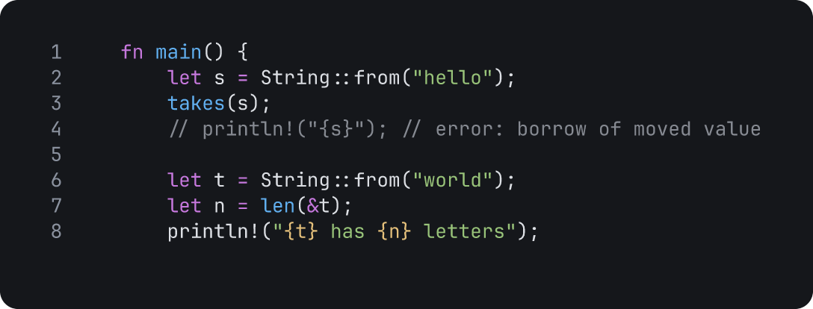
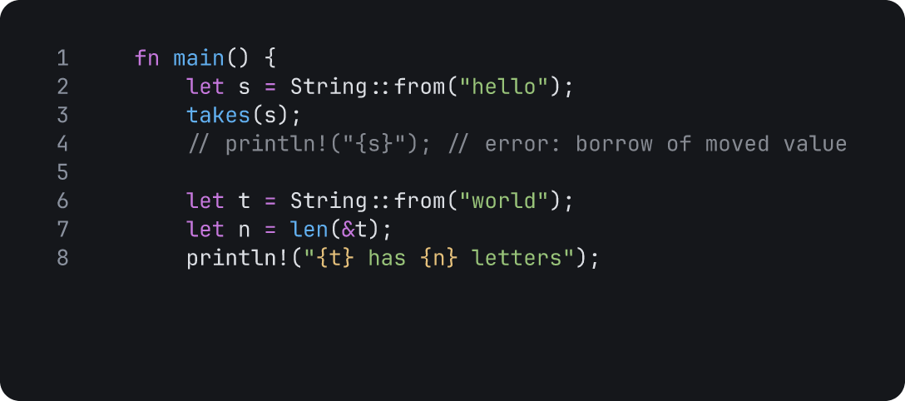

# Animate an explanation

Use this guide to make an explanation that plays by itself. Annotations draw or fade in, Tiza types code, and each step stays for the time that you set. Then present the explanation, or export it to a WebP, a GIF or an MP4.

Tiza is a terminal tool that draws annotations on code. To install it, see [Install](install.md).

You need:

- Tiza and a file of code. This guide uses lines 1 to 8 of `examples/ownership.rs`, from the release archive or the repository.
- For an MP4 or a WebM export, `ffmpeg`. A WebP or a GIF needs no other program.

## 1. Plan the steps

Write one idea for each step. Step 0 shows only the code. The audience reads one change at a time, so put one or two annotations on each step.

The example in this guide has four steps:

1. A note says that `s` owns the text.
2. An arrow shows that `s` moves into `takes`.
3. Tiza types a new line 7.
4. An underline names the new code.

## 2. Draw at each step with an effect

1. Open the lines: `tiza examples/ownership.rs:1-8`. Tiza saves each change to `examples/ownership.rs.1-8.tiza`.
2. Type `:step 1`. A new annotation goes to the step that Tiza shows.
3. Add the note of step 1, with the `fade` effect:

   ```
   :note 2 s owns the text effect=fade
   ```

4. Type `:step 2`, then add the arrow of step 2, with the `draw` effect:

   ```
   :arrow 2:s 3:s/2 moves effect=draw
   ```

   `3:s/2` is the second `s` on line 3, the `s` in `takes(s)`.

- `draw` draws the stroke, then the text comes in. It needs a stroke: a box, a callout, an arrow, or a highlight or a mark with the emphasis `underline`, `brackets` or `strike`.
- `fade` fades the annotation in. It works on every annotation.
- To change the effect of an annotation, type `:set ID effect=draw`. `effect=none` removes the effect. The status bar shows the id when you add an annotation, and the list (`L`) also shows it.
- To move an annotation to the next or the previous step, press `Tab` until Tiza selects it, then press `+` or `-`.

The document and the export of steps 1 and 2:

<!-- frame id=animate-effects doc=docs/frames/animate-effects.tiza animate=0 -->
```json
{
  "schema": 1,
  "source": {},
  "code": {"file": "ownership.rs", "lines": "1-8"},
  "annotations": [
    {"id": "n1", "step": 1, "type": "note", "line": 2, "text": "s owns the text",
     "effect": "fade"},
    {"id": "a1", "step": 2, "type": "arrow", "from": {"line": 2, "col": 8},
     "to": {"line": 3, "col": 10}, "label": "moves", "effect": "draw"}
  ]
}
```



The effects play when you go forward one step. For each rule, see [Enter effects](../reference/document-format.md#enter-effects-experimental).

## 3. Type code at a step

A `code.patch` move changes the code at a step. With `typing`, Tiza types the new code on the screen. No `:` command adds a `code.patch` move. While Tiza runs, open a second terminal and send the move:

```sh
tiza api move.add '{"at_step": 3, "action": "code.patch", "op": "replace", "find": "let n = len(&t);", "content": "    let n = t.len();", "typing": "char", "speed_ms": 60}'
```

In Tiza, type `:step 3`. Tiza types the new code on line 7. When line 7 shows `let n = t.len();`, type `:step 4`, and underline the new code:

```
:hl 7:t.len() a method call emphasis=underline effect=draw
```

- `"typing": "char"` types one character at a time, and `"line"` one line at a time. `speed_ms` is the time of each character or line.
- The annotations of the step come in when the typing ends.
- In normal mode, any key except Ctrl-C ends the typing, and does nothing else. Then press `n` for the next step.
- `tiza api` finds the running Tiza through its socket, from any folder. To use more than one instance, see [Socket API](../reference/socket-api.md).
- An agent can add the same move with the MCP tool `add_move`.

The document and the export of steps 3 and 4:

<!-- frame id=animate-typing doc=docs/frames/animate-typing.tiza animate=0 -->
```json
{
  "schema": 1,
  "source": {},
  "code": {"file": "ownership.rs", "lines": "1-8"},
  "annotations": [
    {"id": "n1", "step": 1, "type": "note", "line": 2, "text": "s owns the text",
     "effect": "fade"},
    {"id": "a1", "step": 2, "type": "arrow", "from": {"line": 2, "col": 8},
     "to": {"line": 3, "col": 10}, "label": "moves", "effect": "draw"},
    {"id": "h1", "step": 4, "type": "highlight", "span": {"line": 7, "start": 12, "end": 19},
     "emphasis": "underline", "label": "a method call", "effect": "draw"}
  ],
  "moves": [
    {"at_step": 3, "action": "code.patch", "op": "replace", "find": "let n = len(&t);",
     "content": "    let n = t.len();", "typing": "char", "speed_ms": 60}
  ]
}
```



For the other operations and the annotations on a changed line, see [Moves](../reference/document-format.md#moves) and [Typing](../reference/document-format.md#typing).

## 4. Move the view

When the code is longer than the screen, move the view before the annotations of a step come in. Then no effect plays out of the view. Type `:step N` for the step, then `:scroll` with the target. For example, in all of `examples/ownership.rs`:

```
:scroll @'fn takes' align=top
```

The view goes to `fn takes` when Tiza reaches the step. `:scroll` refuses a target that is not in the code of the step. The eight lines of this guide fit on the screen, so they need no `scroll`. An export shows all the code, so it ignores a `scroll` move. See [Scroll](../reference/document-format.md#scroll).

## 5. Set the pace

`auto_advance_ms` makes a step go to the next step by itself. The time starts when the typing and the effects of the step end. Send the list of steps from the second terminal:

```sh
tiza scene patch '{"steps": [{"step": 0, "auto_advance_ms": 1000}, {"step": 4, "auto_advance_ms": 6000}]}'
```

- Step 0 shows the code for 1 s, then step 1 starts.
- In a WebP, a GIF, an MP4 or a WebM export, a step with `auto_advance_ms` stays that long. The other steps stay for `--interval`.
- Give the last step a long time, so that the audience can read it. In the TUI, Tiza stays on the last step, unless the document has [`loop`](../reference/document-format.md#loop). A GIF or a WebP plays without end. `--loop N` plays it `N` times.
- `steps` replaces the whole list. To keep the names and the titles of steps, send them in the same list. See [Named steps](../reference/document-format.md#named-steps).

## 6. Check the document

```sh
tiza check examples/ownership.rs.1-8.tiza
```

`tiza check` finds the problems that an audience sees, for example a cut label or a step that shows nothing new. The last line of the report gives the narrowest terminal in which no label is cut. In parentheses, it gives the columns of code at that width. That is the width for `tiza render`, which has no padding. The check looks only at the labels, so the code can need a wider export: see section 8. For all of the report, see [Check before you record](check-before-you-record.md).

## 7. Present it

Quit Tiza with `:wq`. Then open the document in presentation mode, at step 0:

```sh
tiza examples/ownership.rs.1-8.tiza --present --step 0
```

Without `--step 0`, Tiza opens the document at the step on which you saved it.

Presentation mode hides the status bar and the cursor. Press `n` or `→` for the next step, and `p` or `←` for the previous step. `P` starts or stops presentation mode.

A step back shows the final drawing, with no effect. For all the keys and an image of presentation mode, see [Present](../reference/keys.md#present).

## 8. Export it

`tiza render` writes all the steps into the file of `--out`. The extension of the file gives the format:

```sh
tiza render examples/ownership.rs.1-8.tiza --out demo.webp --width 63
tiza render examples/ownership.rs.1-8.tiza --out demo.gif --width 63
tiza render examples/ownership.rs.1-8.tiza --out demo.mp4 --width 63
```

- The recording starts at step 0, so that the effects of step 1 play. The first step of a recording shows its final drawing.
- `--interval S` is the time of each step without `auto_advance_ms`, in seconds. The default is 2.
- To pick the width, export a step as text at a few widths. Use the narrowest width at which no line ends in `…`:

  ```sh
  tiza render examples/ownership.rs.1-8.tiza --step 4 --format txt --width 63
  ```

- `--margin N` adds a blank margin of `N` cells on each side.

The result, from step 0, with the pace of section 5:

<!-- frame id=animate-result doc=docs/frames/animate.tiza animate=0 -->
```json
{
  "schema": 1,
  "source": {},
  "code": {"file": "ownership.rs", "lines": "1-8"},
  "annotations": [
    {"id": "n1", "step": 1, "type": "note", "line": 2, "text": "s owns the text",
     "effect": "fade"},
    {"id": "a1", "step": 2, "type": "arrow", "from": {"line": 2, "col": 8},
     "to": {"line": 3, "col": 10}, "label": "moves", "effect": "draw"},
    {"id": "h1", "step": 4, "type": "highlight", "span": {"line": 7, "start": 12, "end": 19},
     "emphasis": "underline", "label": "a method call", "effect": "draw"}
  ],
  "steps": [
    {"step": 0, "auto_advance_ms": 1000},
    {"step": 4, "auto_advance_ms": 6000}
  ],
  "moves": [
    {"at_step": 3, "action": "code.patch", "op": "replace", "find": "let n = len(&t);",
     "content": "    let n = t.len();", "typing": "char", "speed_ms": 60}
  ]
}
```


For the timing of each format, see [Timing of a recording](../reference/exports.md#timing-of-a-recording). For the other formats and options, see [Exports](../reference/exports.md).

## See also

- [Enter effects](../reference/document-format.md#enter-effects-experimental)
- [Check before you record](check-before-you-record.md)
- [Exports](../reference/exports.md)
- [Keys](../reference/keys.md)
