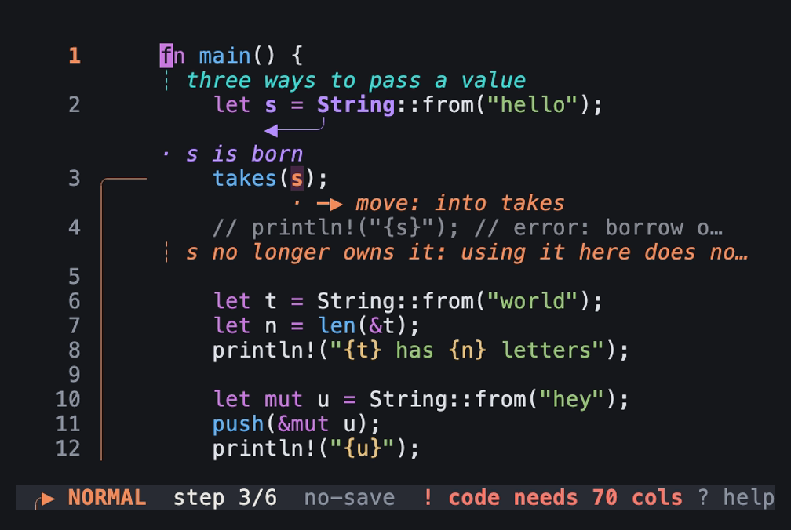
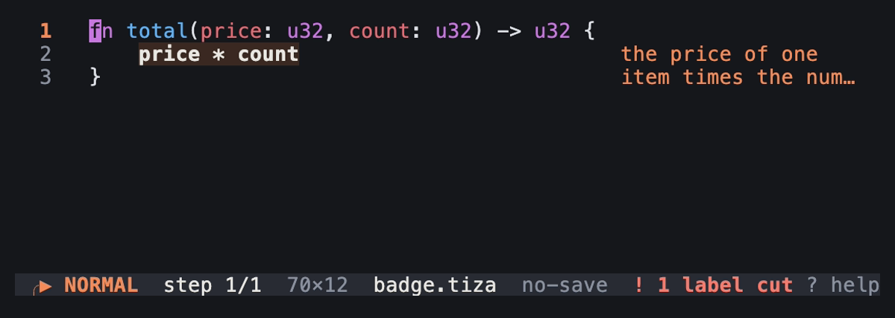

# Check before you record

Use this checklist before you record a video or a GIF. `tiza check` finds the problems of a document before you record it.

Tiza is a terminal tool that draws annotations on code. To install it, see [Install](install.md).

## Checklist

1. Run `tiza check demo.tiza`. It loads the document as the TUI does, and lists every problem at once.
2. Fix the errors. When there is an error, `tiza check` exits with 1.
3. Read the warnings. Add `--strict` to make a warning also exit with 1.
4. Pick the width. The last line of the report gives the narrowest width from which no label is cut. Use that width or more. A `clipped_code` warning gives the width from which no code line is cut, or tells you that no width up to 400 shows every code line whole.
5. Use demo values for tokens, passwords and credentials. The audience sees what is in the file.
6. Set up the terminal. See [Terminal and font](#terminal-and-font).
7. Before you record, type `:layout stable`, which shows the take, and go through the steps in normal mode. Look for a `!` badge on the status bar. See [Badges on the status bar](#badges-on-the-status-bar).

## What check reports

`tiza check` does not change any file. It checks the labels and the code lines at the width that you record at: the `width` of your config file, else 100 columns, or `--width N`.

The table gives the usual problems. Each finding in the JSON output also has a `code`.

| Problem | Level |
|---|---|
| The document does not follow the `.tiza` format. | Error |
| An anchor, a marker or a move target does not match at its step. A `scroll` move is the exception. | Error |
| A move target matches more than one time at its step, and the move has no `occurrence`. A `scroll` move is the exception. | Error |
| The target of a `scroll` move does not match at its step, or a `find` matches more than one time and the move has no `occurrence`. The move does not place the view, or goes to the first match. | Warning |
| A linked file cannot be read. | Error |
| An id in the `ids` of a spotlight is unknown. | Error |
| Two annotations have the same id. | Error |
| A move removes the code that an annotation is on. | Warning |
| An annotation is outside the `code.link` window of its step. | Warning |
| A later `code.patch` pushes an annotation out of the `code.link` window. | Warning |
| An annotation belongs to a file that its own step does not show. | Warning |
| A label is cut with `…`, or has no space and is not drawn, at the width that you record at. | Warning |
| A code line is cut with `…` at the width that you record at. | Warning |
| A step changes nothing. | Warning |
| The `until` of a spotlight is before its `step`. The spotlight never shows. | Error |
| An annotation has the enter effect `draw` but no stroke, or an effect that this version of Tiza does not know. | Warning |
| A move has an action, a value or a key that this version of Tiza does not know. Tiza skips the move, uses the default value, or ignores the key. | Warning |
| A marker (`find_start` or `find_end`) matches more than one time. | Warning |
| A `rebind` names an unknown id. Tiza ignores that `rebind`. | Warning |

- `tiza check` reports a file that its own step does not show also when the file shows at other steps. Tiza never draws the annotation at its own step.
- For a marker that matches more than one time, the warning gives the lines of each match. The range takes the first match.

Each finding is one line: `LEVEL: ID, step N, FILE, LINE: MESSAGE`.

- `LEVEL` is `error` or `warning`.
- `ID`, `step N`, `FILE` and `LINE` show only when they apply. With none of them, the line is `LEVEL: MESSAGE`.
- `FILE` shows for a finding in a linked file.
- `LINE` is `L` and the line number of the code. For a `schema` finding, it is `line N`, the line in the `.tiza` file.

For example:

```
error: x1, step 2, L99: line 99 does not exist (the document spans 1 to 25)
warning: step 7: nothing new on this step: the presenter presses a key and nothing changes
```

### The width line

The report ends with the narrowest width from which no label is cut, at that width and at each wider width. For example, for `examples/ownership.rs.tiza`, the line is:

```
no label is clipped at 91 or wider (`tiza render --width 91`)
```

At a narrow width, notes go under their lines. Then a narrower width can be clean again. When you ask for such a width, the report gives that range too. For example, with `--width 80`:

```
no label is clipped at 91 or wider; 70-84 are clean too (notes go under the lines below 85 columns)
```

- When no width up to 400 shows each label, the line is `no width up to 400 shows every label whole: shorten the labels`.
- When the document does not load, the report has no width line.

## Badges on the status bar

The status bar shows the terminal size as `COLS×ROWS`. It shows a `!` badge only when the step on screen cuts or hides a label, a note or a code line.

| Status bar | Meaning |
|---|---|
| `! N labels cut` | `N` labels or notes are cut with `…`, or are not drawn. |
| `! code needs N cols` | A code line is cut. |

- In `! code needs N cols`, `N` is the narrowest terminal width that shows every code line of the step.
- In normal mode, the badge tells what the screen cuts, and `tiza check` tells what the take cuts. With `:layout dynamic`, the default, the screen at an earlier step has no space yet for the arrows, the boxes and the code of later steps, so the two can differ. See [`:layout`](../reference/commands/view.md#layout).
- The status bar shows one badge at a time. `! code needs N cols` comes before `! N labels cut`.
- When the status bar has no space, `! N labels cut` gets shorter and shows only `!`.
- The `status` reply of the API lists the details in `warnings`, for example `2 labels cut at 40 columns: a4, a3`.



Step 3 of `examples/ownership.rs.tiza` at 58 columns: an image of the TUI in a real terminal of 58 columns and 20 rows, with the Menlo font.



A document of three lines with one long label, at 70 columns: an image of the TUI in a real terminal of 70 columns and 12 rows, with the Menlo font.

## Terminal and font

- Use a full-screen terminal, or one that fills half of the screen next to Zed.
- Use a font of 18 to 22 px.
- Keep a snippet to 60 columns or fewer.
- The exports set all the text in JetBrains Mono: the code, the notes, the labels and the legends. Use JetBrains Mono in the terminal to make it match the exports. Any other monospace font also works.

## Narrow terminals

- Below about 100 columns, Tiza draws notes under their lines, not in the margin.
- The width depends on the document. `tiza check` gives it: see [The width line](#the-width-line).
- For an arrow between two lines, the label then goes on the row of the arrowhead, after the code, when it fits. Otherwise, it goes on the row below. In both places, the glyph of the arrow comes first: `─▶ move`. Thus the label reads as part of the arrow, not as a separate comment.
- The label of an arrow on one line goes on a row under the arrow.
- On a narrow terminal, Tiza also draws a callout with `placement: auto` or `placement: margin` under its lines.
- By default, Tiza keeps one blank column at each side. `pad` in the [config file](../reference/config.md#defaults) changes this default. `:pad V H` changes the padding. `:pad 0 0` removes it. `:pad default` sets it back.

## JSON output

`tiza check --json` gives the same findings to a script. Its fields and codes are in [Check report](../reference/cli.md#check-report).

## Check a live instance

A live instance gives the same report for the document that it holds. The report includes the changes that are not saved. Use `tiza api check '{"width": 108}'`, or the MCP tool `check`.

- Only a live instance gives `stale` findings.
- The reply of a live instance also has `revision`.

## How it works

Both themes use explicit RGB colors for 1080p video. `scripts/legibility.py` runs in CI on the last step of `examples/ownership.rs.tiza`, in the dark and the light theme. It measures each text color of that frame after a compression like the one on YouTube. Each one keeps a contrast of 4.5:1 or more against the background.
