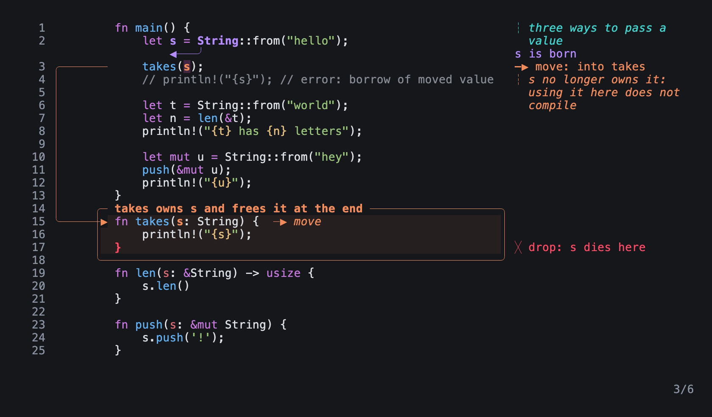
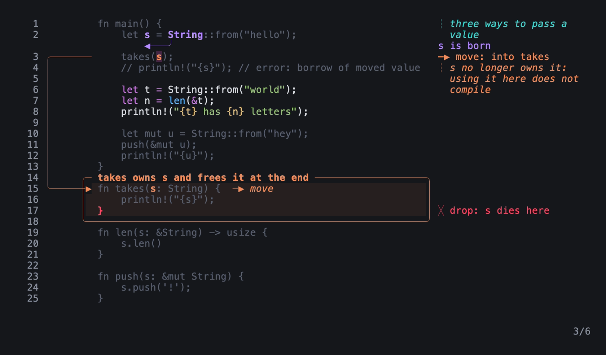

# Present a take

Use this guide to present a document to people: in a room, in a call or for a screen recording. Presentation mode shows only the code and the annotations, and you go through the steps with one key. It shows the take: one layout for all the steps, so a label stays in the same place from one step to the next.

Tiza is a terminal tool that draws annotations on code. To install it, see [Install](install.md).

You need:

- Tiza and a `.tiza` document with steps. This guide uses `examples/ownership.rs.tiza`, from the release archive or the repository. To make a document with steps, see [Animate an explanation](animate-an-explanation.md).

## 1. Get the document ready

1. Run `tiza check examples/ownership.rs.tiza`. Fix each error. The last line of the report gives the narrowest terminal width that cuts no label.
2. Open the document: `tiza examples/ownership.rs.tiza --no-save`. Type `:layout stable`, which shows the take in normal mode for this session.
3. Go through the steps. A `!` badge on the status bar tells you that the step cuts a label or a code line. See [Badges on the status bar](check-before-you-record.md#badges-on-the-status-bar).

For each item that check reports, see [Check before you record](check-before-you-record.md).

## 2. Set up the terminal

1. Make the terminal as wide as the last line of the `tiza check` report gives, or wider. In normal mode, the status bar shows the size of the terminal as `COLS×ROWS`.
2. For a room or a recording, use a large font. See [Terminal and font](check-before-you-record.md#terminal-and-font).

To keep more blank cells around the code, for example for the frame of a recording, add `--padding V,H` to the command in step 3. Tiza does not save it in the document. More padding needs a terminal wider than the width that `tiza check` gives. To change the theme, add `--theme light` or `--theme dark` to the command in step 3. Press `t` to change it while you present. For the colors in tmux and in other terminals, see [Terminal support](../reference/terminals.md).

## 3. Open the document in presentation mode

From the folder that holds `examples/`, run:

```sh
tiza examples/ownership.rs.tiza --present --step 0 --no-save
```

- `--present` starts in presentation mode.
- `--step 0` starts at step 0. Without it, Tiza opens the document at the step on which you saved it.
- `--no-save` starts in no-save mode. Thus a command that you type by mistake does not change the file.



Step 3 of `examples/ownership.rs.tiza` in presentation mode: an image of the TUI in a real terminal of 100 columns and 30 rows, with the Menlo font.

Presentation mode hides the status bar and the cursor. The last row shows the step counter at the right, for example `3/6` for step 3 of 6. To record a take without it, add `--no-counter` to the command, or set `counter = false` in the [config file](../reference/config.md). Then the last row shows code. `P` starts and stops presentation mode, also when you opened the document without `--present`.

## 4. Go through the steps

| Key | What it does |
|---|---|
| `→`, `n` or `PageDown` | Goes to the next step. |
| `←`, `p` or `PageUp` | Goes to the previous step. |

Many remotes send `PageDown` and `PageUp`, which change the step.

- To go to a step by its number or its name, type `:goto 4`, or `:goto ID` with the `id` of a named step.
- When a step types code, the next key ends the typing. It does not go to the next step. See [Go to a step](../reference/keys.md#go-to-a-step).
- A step back shows the annotations of that step with no effect.
- A document with `auto_advance_ms` goes to the next step by itself, also in presentation mode. An open `:` line holds the countdown, and `Esc` closes the line. With `"loop": true`, the step after the last is step 0. See [Auto-advance](../reference/document-format.md#auto-advance) and [Loop](../reference/document-format.md#loop).

## 5. Point at the code

The live pointer works like a laser pointer. The lines of the pointer keep their colors, and the rest of the code dims.

1. Press `f`. The pointer shows the line of the hidden cursor.
2. Move it with `j` and `k`. Press `Tab` to go to the next annotation in the view, and `Shift-Tab` to go to the previous one.
3. Press `f` or `Esc` to turn it off.

With the pointer off, `Esc` stops presentation mode. Press `P` to come back.

To point at a group of lines:

1. Put the pointer on the first line of the group.
2. Press `f` to turn it off, then press `V`. `V` starts a selection of lines, which presentation mode does not show.
3. Press `j` to go to the last line of the group.
4. Press `f`.



The live pointer on lines 6 to 8, at step 3 of `examples/ownership.rs.tiza` in presentation mode: an image of the TUI in a real terminal of 100 columns and 30 rows, with the Menlo font.

Tiza never saves the pointer, and an export never shows it. See [The live pointer](../reference/keys.md#the-live-pointer).

## 6. Move the view

With the live pointer off, these keys move the view, as in a web browser:

- `j`, `k`, `↓` and `↑` move it one row. A trackpad or a mouse wheel also moves it.
- `J` and `K` move it half a screen.
- `g` and `G` go to the start and the end of the code.

When you go to the next step, its new annotations come into the view. A `scroll` move of the step puts the view on its target. See [Scroll](../reference/document-format.md#scroll).

## 7. Answer a question

- Press `:` to type a command. Its result shows on the last row for 2 seconds, or until the next key. To cancel the command, press `Esc`.
- `u` does nothing in presentation mode. To undo, type `:undo`.
- To show the status bar or to edit, press `P`. Normal mode shows the same step. Press `P` again to come back.

## 8. Finish

Press `q`. When you changed the document in no-save mode, `q` refuses. The last row shows `not closed: unsaved changes · :q! quits without saving` for 2 seconds. Then type `:q!`, which quits without saving. A `:` command that changes the document, such as `:theme light`, is a change. `t` and a change of step are not.

Without `--no-save`, `q` saves no more than the current mode saves. See [Quitting](../concepts/saving.md#quitting).

You presented all the steps of the document, and the file did not change.

## Special cases

- **The terminal changes size:** the view stays on the same code. The step counter stays on the last row.
- **An agent changes the document:** the last row shows `⏸ N to review · :review` at the left. See [Supervise an agent](supervise-an-agent.md).
- **The mouse:** a click or a drag does nothing in presentation mode. See [Presentation mode](use-the-mouse.md#presentation-mode).
- **`Ctrl-C`:** it quits when no panel, command line or selection is open. In no-save mode, it quits without saving and prints what it did not save. See [Ctrl-C](../reference/keys.md#ctrl-c).

## See also

- [Present](../reference/keys.md#present), all the keys and rules of presentation mode
- [Animate an explanation](animate-an-explanation.md)
- [Check before you record](check-before-you-record.md)
- [Command line](../reference/cli.md)
