# Annotation commands

Use these commands to add an annotation. A new annotation goes to the step on screen. See [Annotations](../document-format.md#annotations). Press `:` to open the command line. Type the command. Press `Enter`. The arguments, such as `L:TEXT` and `A-B`, are in [Arguments](../commands.md#arguments).

Each image on this page is a frame of a `tiza render` export. The code is `examples/ownership.rs`. Each frame shows only the lines that it needs.

`effect=E` sets the enter effect of the new annotation: draw or fade. See [Enter effects](../document-format.md#enter-effects-experimental).

Tiza puts a label, a legend or a note in the right margin when the margin has room. When it has no room, Tiza puts it under the line. The frames on this page are narrow, so their labels are under the line.

- Under the line, the label of a highlight or a mark starts under its span when it fits there.
- The label of an arrow that goes to another line is beside the code of that line, after the glyph of the arrow, when the code column has room for it. When it has no room, the label goes in the right margin or under the line.

## `:mark`

Adds a mark on a span of code. The mark has a glyph, a legend and your label.

```
:mark KIND L:TEXT [LABEL] [emphasis=E] [effect=E]
```

<dl>
<dt><code>emphasis=E</code></dt>
<dd>

How Tiza draws the span.

`fill` (default) | `underline` | `brackets` | `strike`

</dd>
</dl>

`KIND` is a built-in kind, an alias, the name of a style, the name of a personal style of the [config file](../config.md#styles), or a glyph. The kinds are in [Kinds](../document-format.md#kinds).

For example, mark `takes` on line 3 with the `move` kind:

<!-- frame id=mark-default code=examples/ownership.rs:1-3 -->
```
:mark move 3:takes the value moves
```

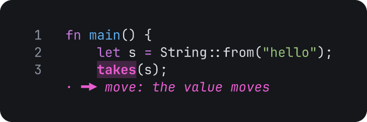

### `:mark` with a color

`KIND@COLOR` sets the color of the mark. The colors are in [Color names](../document-format.md#color-names).

<!-- frame id=mark-color code=examples/ownership.rs:1-3 -->
```
:mark warn@red 3:takes the value moves
```

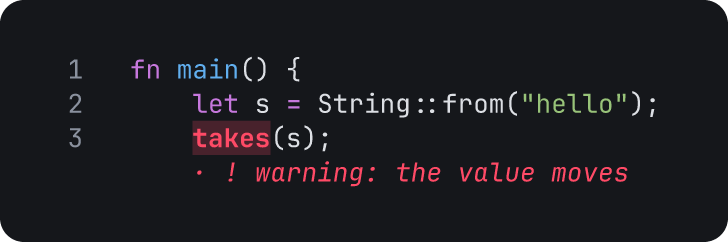

### `:mark` with an emphasis

The frames of the other values are in [`:hl` with an emphasis](#hl-with-an-emphasis).

<!-- frame id=mark-emphasis code=examples/ownership.rs:1-3 -->
```
:mark move 3:takes the value moves emphasis=underline
```

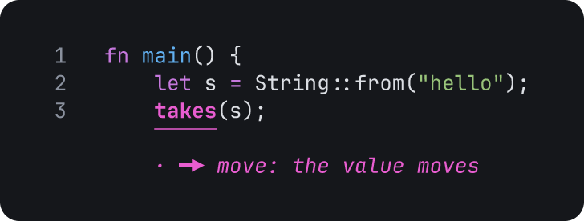

### `:mark` with a glyph

A glyph in place of `KIND` makes a style for this mark only. Tiza uses the label as the legend. A glyph is one or two columns wide. It has no ASCII letter or digit.

<!-- frame id=mark-glyph code=examples/ownership.rs:1-3 -->
```
:mark 🔥 3:takes hot path
```

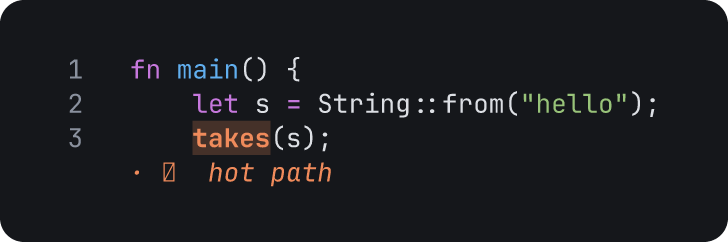

### Notes on `:mark`

- The anchor ends at the first space. To mark text that has a space, select it with `v` and press `m`. See [Annotate a selection](../keys.md#annotate-a-selection).
- After you press `m` on a selection, `:mark` uses the selected text. Then type only the kind and the label.

## `:hl`

Adds a highlight and your label on a span of code.

```
:hl L:TEXT [LABEL] [emphasis=E] [effect=E]
```

<dl>
<dt><code>emphasis=E</code></dt>
<dd>

How Tiza draws the span.

`fill` (default) | `underline` | `brackets` | `strike`

</dd>
</dl>

For example, highlight `&t` on line 7:

<!-- frame id=hl-default code=examples/ownership.rs:6-8 -->
```
:hl 7:&t shared borrow
```

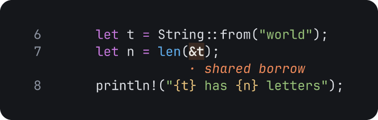

### `:hl` with an emphasis

`underline` draws a line under the span:

<!-- frame id=hl-underline code=examples/ownership.rs:6-8 -->
```
:hl 7:&t shared borrow emphasis=underline
```

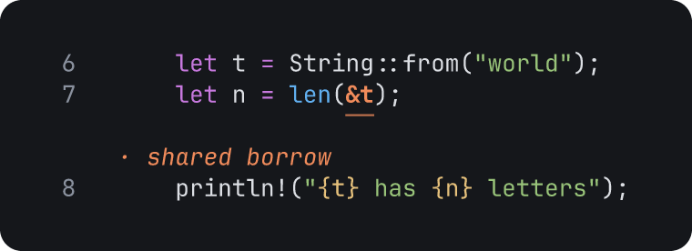

`brackets` draws two corners under the span:

<!-- frame id=hl-brackets code=examples/ownership.rs:6-8 -->
```
:hl 7:&t shared borrow emphasis=brackets
```

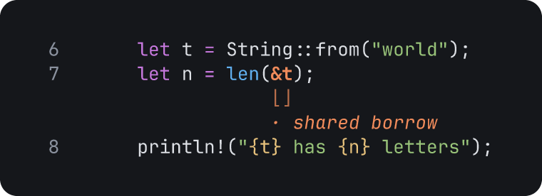

`strike` draws a line through the span:

<!-- frame id=hl-strike code=examples/ownership.rs:6-8 -->
```
:hl 7:&t shared borrow emphasis=strike
```

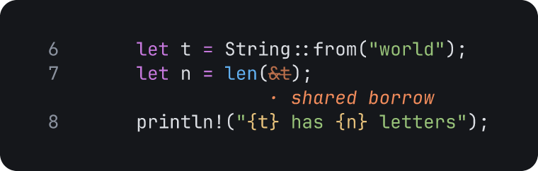

### Notes on `:hl`

- The anchor ends at the first space. For example, `:hl 2:let s two words` highlights `let`. Its label is `s two words`.
- To highlight text that has a space, select it with `v` and press `h`.
- `:hl` also accepts `style=` as another name for `emphasis=`.

## `:arrow`

Adds an arrow from one span to another span, with your label.

```
:arrow L:TEXT L:TEXT [LABEL] [stroke=S] [route=R] [heads=START,END] [effect=E]
```

<dl>
<dt><code>stroke=S</code></dt>
<dd>

The line of the arrow.

`solid` (default) | `dashed` | `dotted` | `thick` | `double`

</dd>
<dt><code>route=R</code></dt>
<dd>

The corners of the line.

`rounded` (default) | `sharp`

</dd>
<dt><code>heads=START,END</code></dt>
<dd>

The head at the start and the head at the end. `heads=END` sets only the end head.

`none` | `arrow` | `dot` | `bar` | `open`

Default: `none,arrow`.

</dd>
<dt><code>start=H</code>, <code>end=H</code></dt>
<dd>

One head: the head at the start, or the head at the end.

The values of `heads`.

</dd>
</dl>

Each end is the first character of its text. For example, draw an arrow from `s` on line 2 to `s` on line 3:

<!-- frame id=arrow-default code=examples/ownership.rs:1-3 -->
```
:arrow 2:s 3:s) the value moves
```

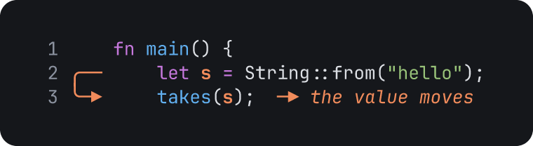

A dashed arrow that starts with a dot:

<!-- frame id=arrow-stroke code=examples/ownership.rs:6-8 -->
```
:arrow 6:t/2 7:&t borrow stroke=dashed heads=dot,arrow
```

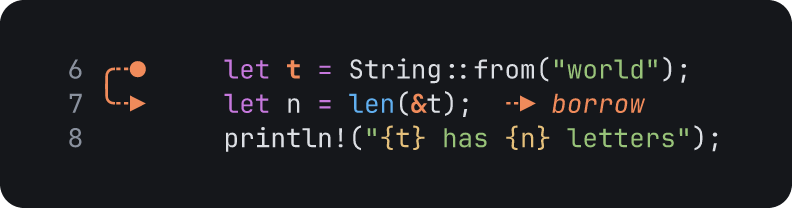

A thick arrow with sharp corners:

<!-- frame id=arrow-route code=examples/ownership.rs:10-12 -->
```
:arrow 10:u/2 11:&mut write stroke=thick route=sharp
```

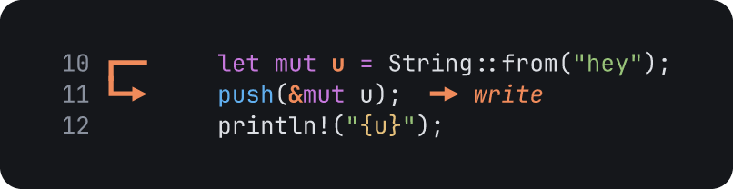

### Notes on `:arrow`

- An end can also be `.:TEXT`, the first `TEXT` on the cursor line. It can also be `L` or `L:`, the start of line `L`. It can also be `TEXT` alone, the first `TEXT` in the code.

## `:box`

Adds a box with your label around lines.

```
:box A-B [LABEL] [border=S] [corners=R] [fill=F] [effect=E]
```

<dl>
<dt><code>border=S</code></dt>
<dd>

The line of the border.

`solid` (default) | `dashed` | `dotted` | `thick` | `double`

</dd>
<dt><code>corners=R</code></dt>
<dd>

The corners of the box.

`rounded` (default) | `sharp`

</dd>
<dt><code>fill=F</code></dt>
<dd>

The tint inside the box.

`yes` (default) | `no`

</dd>
</dl>

For example, put a box around lines 6 to 8:

<!-- frame id=box-default code=examples/ownership.rs:5-9 -->
```
:box 6-8 shared
```


A box with a double border, sharp corners and no tint:

<!-- frame id=box-border code=examples/ownership.rs:5-9 -->
```
:box 6-8 shared border=double corners=sharp fill=no
```

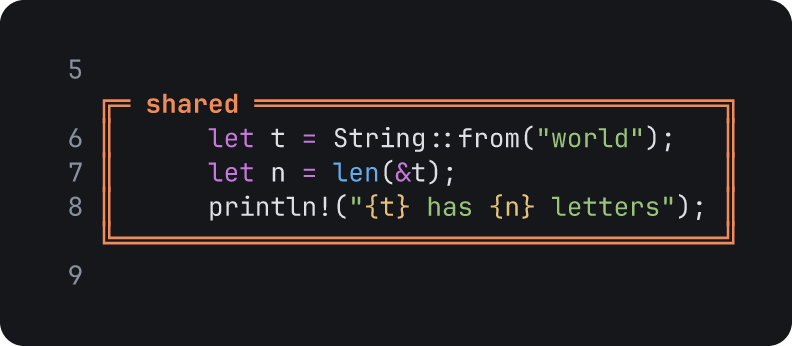

### `:box` with two markers

A range of two markers finds the lines from their text. Tiza keeps the two markers in the document. It finds the range again after the code changes.

<!-- frame id=box-markers code=examples/ownership.rs:5-9 -->
```
:box @'let t'..@'println' shared
```

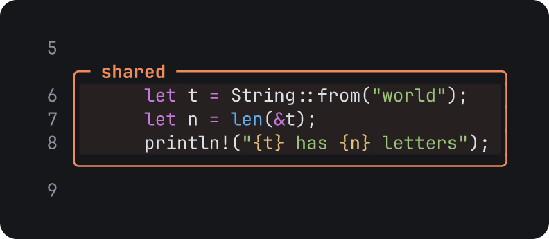

### Notes on `:box`

- A range can also be `A..B` or `A:B`. Write it without spaces.
- `:box .` uses the cursor line as the range.
- Put a marker in `'` or `"` quotes when it has a space.

## `:note`

Adds a note, a line of text, for a line of code. Tiza draws the note in the right margin when the margin has room. When the margin has no room, Tiza draws the note under the line, as in this frame.

```
:note L TEXT [effect=E]
```

For example, add a note on line 3:

<!-- frame id=note-default code=examples/ownership.rs:2-3 -->
```
:note 3 s moves into takes
```

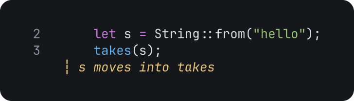

### Notes on `:note`

- A note needs text.
- `L` can be `.`, the cursor line.

## `:callout`

Adds a callout, a paragraph of text, for lines of code.

```
:callout A[-B] [@PLACE] [title="TEXT"] TEXT [border=S] [corners=R] [fill=F] [effect=E]
```

<dl>
<dt><code>@PLACE</code></dt>
<dd>

Where the callout goes.

`@margin` (default) | `@below` | `@auto`

</dd>
<dt><code>title="TEXT"</code></dt>
<dd>

A title for the callout. Put it before the text.

</dd>
<dt><code>border=S</code></dt>
<dd>

The line of the border.

`solid` (default) | `dashed` | `dotted` | `thick` | `double`

</dd>
<dt><code>corners=R</code></dt>
<dd>

The corners of the callout.

`rounded` (default) | `sharp`

</dd>
<dt><code>fill=F</code></dt>
<dd>

The tint inside the callout.

`no` (default) | `yes`

</dd>
</dl>

For example, add a callout for lines 6 to 8:

<!-- frame id=callout-default code=examples/ownership.rs:6-8 width=66 -->
```
:callout 6-8 t stays with main.
```

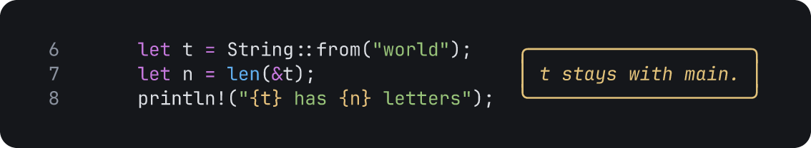

When the right margin has no room, Tiza puts the callout under the lines.

### `:callout` with a place and a title

`@margin` puts the callout in the right margin. `@below` puts it under the lines. `@auto` puts it where there is room.

<!-- frame id=callout-below code=examples/ownership.rs:6-8 -->
```
:callout 6-8 @below title="Borrow" len reads t and gives it back.
```

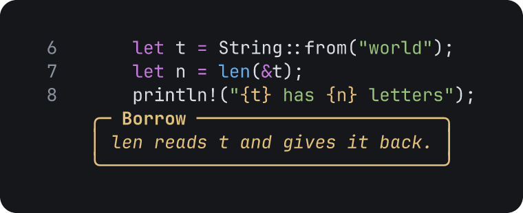

### Notes on `:callout`

- A callout needs text.
- `:callout .` uses the cursor line. A range can also be `A..B` or `A:B`. See [Arguments](../commands.md#arguments).

## `:spot`

Adds a spotlight. At its step, Tiza dims the code and the annotations outside the lines. Tiza does not dim an annotation that you name, or its code.

```
:spot A-B [ID…] [effect=E]
:spot ID… [effect=E]
```

For example, highlight `&t`, then put a spotlight on lines 7 and 8:

<!-- frame id=spot-default code=examples/ownership.rs:6-8 -->
```
:hl 7:&t shared borrow
:spot 7-8
```

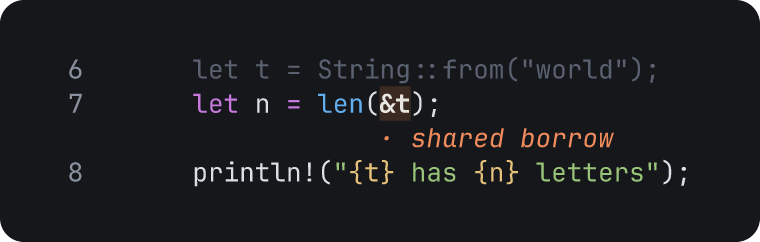

### Notes on `:spot`

- `:spot ID…` adds a spotlight on the annotations that you name. The fields are in [`spotlight`](../document-format.md#spotlight).
- A spotlight draws nothing. It only dims.
- An annotation that touches the lines keeps its color, for example an arrow from a line outside to a line inside. See [Rules for annotations](../document-format.md#rules-for-annotations).
- A line range and the ids can come in any order. A marker range must come first, for example `:spot @'fn len'..@'}'`.
- A word that starts with a digit is a line range. When you give two line ranges, Tiza uses the last one.
- `:spot .` reads `.` as an id, not as the cursor line.

## `:until`

Keeps a spotlight active up to a later step.

```
:until ID N
```

For example, `:until a2 4` keeps the spotlight `a2` active from its step to step 4.

- `N` cannot be before the step of the spotlight.
- A frame shows one step. This page has no frame for `:until`.

## `:style`

Defines a mark style, changes it, or removes it.

```
:style NAME glyph=G legend="TEXT" color=C
:style NAME
:style
```

<dl>
<dt><code>glyph=G</code></dt>
<dd>

The glyph of the mark.

</dd>
<dt><code>legend="TEXT"</code></dt>
<dd>

The legend next to the glyph. Put text with spaces in `"` quotes.

</dd>
<dt><code>color=C</code></dt>
<dd>

The color of the mark.

The names are in [Color names](../document-format.md#color-names).

</dd>
</dl>

For example, define the style `io` and use it in a mark:

<!-- frame id=style-default code=examples/ownership.rs:1-3 -->
```
:style io glyph=⇄ legend="network I/O" color=cyan
:mark io 2:String
```

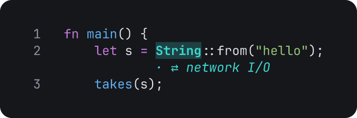

### Notes on `:style`

- `:style NAME` removes the style. When `NAME` is not a style, Tiza shows the usage.
- `:style` alone shows the styles, the personal styles of the config file that the document does not have, and the built-in kinds.
- A style is a custom kind. Tiza saves it in the document.
