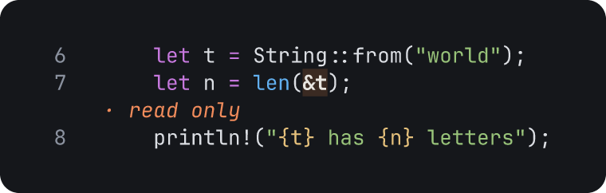
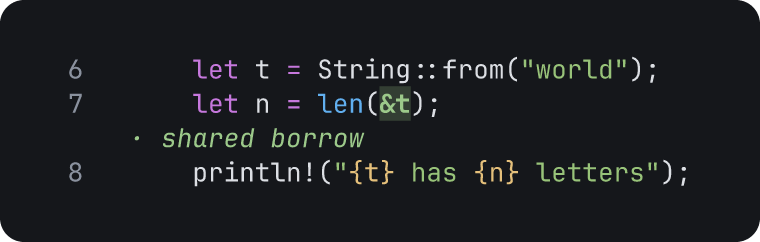
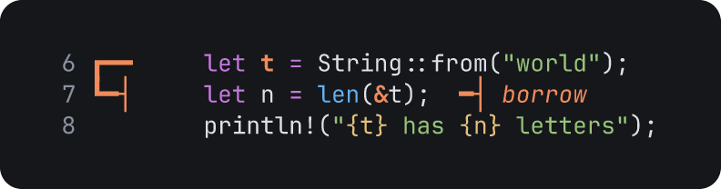

# Change commands

Use these commands to change or delete an annotation. Each command except `:clear` takes the id of an annotation, for example `a1`. The status bar shows the id when you add an annotation. The annotation list (`L`) also shows it.

Each image on this page is a frame of a `tiza render` export. The code is `examples/ownership.rs`. The first command of each frame adds the annotation that the second command changes. A deleted annotation draws nothing, so `:step ID N`, `:del` and `:clear` have no frame.

## `:label`

Changes the label of an annotation.

```
:label ID TEXT
```

For example, change the label of the highlight `a1`:

<!-- frame id=label-default code=examples/ownership.rs:6-8 -->
```
:hl 7:&t shared borrow
:label a1 read only
```



### Notes on `:label`

- `:label` also changes the text of a note and the title of a callout.
- A spotlight has no label. `:label` does not change it.

## `:color`

Changes the color of an annotation.

```
:color ID COLOR
```

`COLOR` is a color name, `#rrggbb` or `auto`. `auto` gives the default color back. The color names are in [Color names](../document-format.md#color-names).

<!-- frame id=color-default code=examples/ownership.rs:6-8 -->
```
:hl 7:&t shared borrow
:color a1 green
```



### Notes on `:color`

- `:color ID` without a color sets `auto`.

## `:set`

Changes one or more properties of an annotation.

```
:set ID KEY=VALUE…
```

For example, make an arrow thick and give it a bar head:

<!-- frame id=set-default code=examples/ownership.rs:6-8 -->
```
:arrow 6:t/2 7:&t borrow
:set a1 stroke=thick end=bar
```



`:set` takes these properties:

| Property | Annotations |
|---|---|
| `label`, `color` and `step` | All the annotations. |
| `stroke`, `route`, `heads`, `start` and `end` | Arrows. |
| `border`, `corners` and `fill` | Boxes and callouts. |
| `emphasis` | Highlights and marks. |

The values are the same as in [Annotation commands](annotate.md). The fields are in [Annotations](../document-format.md#annotations).

### Notes on `:set`

- `label` also has the names `text` and `title`.
- On a highlight, `emphasis` also has the name `style`.

## `:step ID N`

Moves an annotation to step `N`.

```
:step ID N
```

For example, `:step a3 2` moves `a3` to step 2.

- `N` is a step from 1 to the step after the last step.
- `:step N` without an id goes to a step. See [`:step`](steps-and-files.md#step).

## `:del`

Deletes one or more annotations.

```
:del ID…
```

For example, `:del a2 a5` deletes `a2` and `a5`.

- `:del` deletes the ids in order. It stops at the first id that does not exist. It keeps the deletes before that id.
- `:del` records one undo step for each id. For example, after `:del a1 a2`, one `u` brings back only `a2`. Press `u` again to bring back `a1`.

## `:clear`

Deletes the annotations of all the steps, or of one step.

```
:clear
:clear N
:clear .
```

- `:clear` deletes all the annotations.
- `:clear N` deletes the annotations of step `N`.
- `:clear .` deletes the annotations of the step on screen.
- `u` undoes `:clear`.
