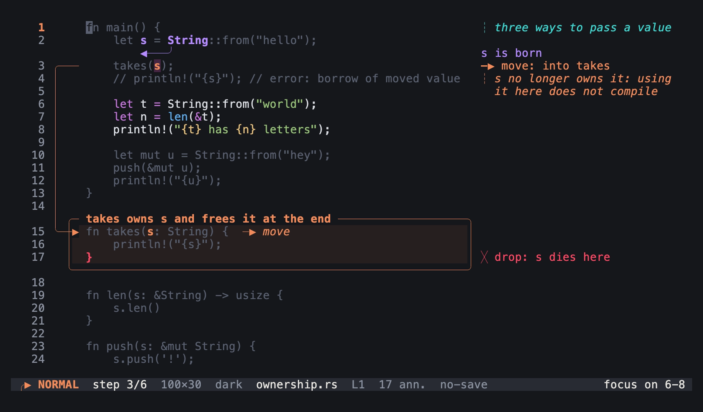
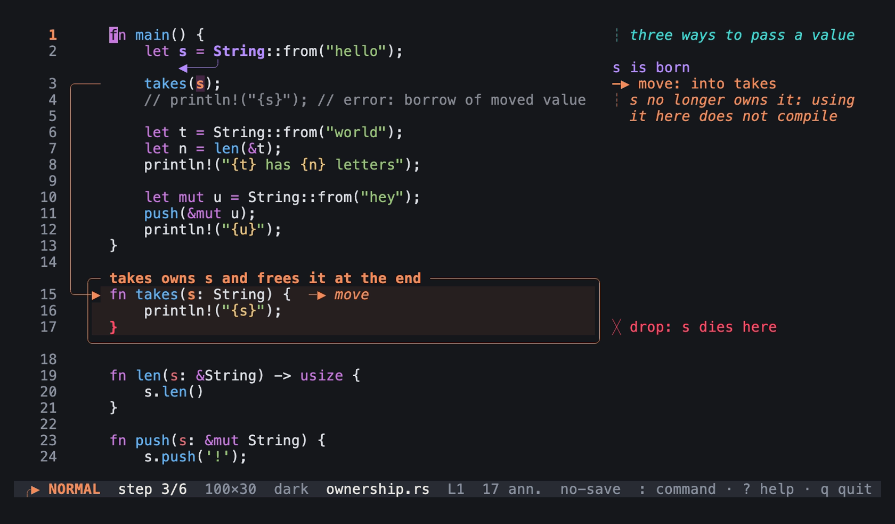
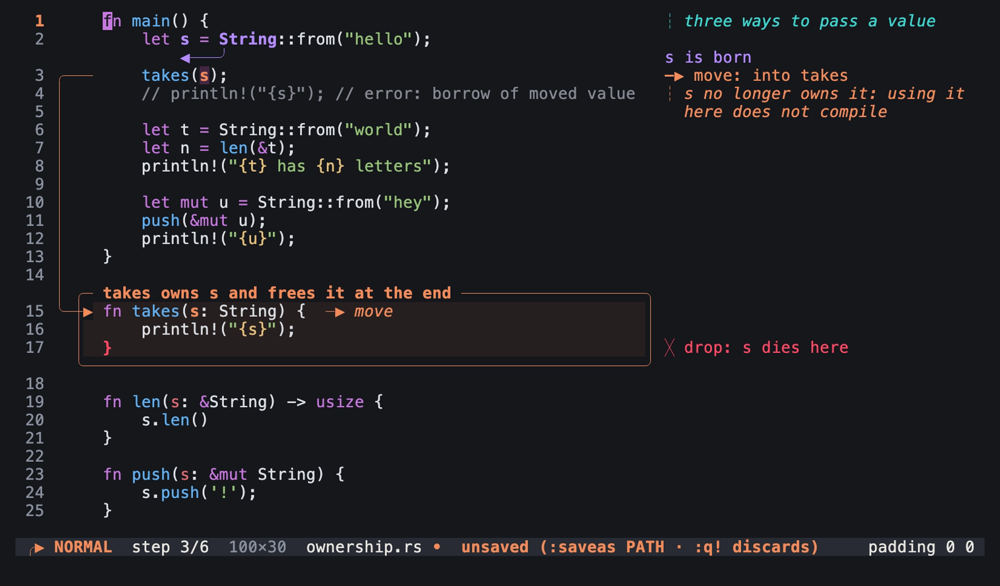
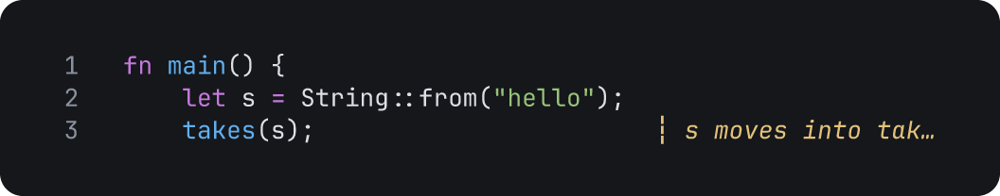
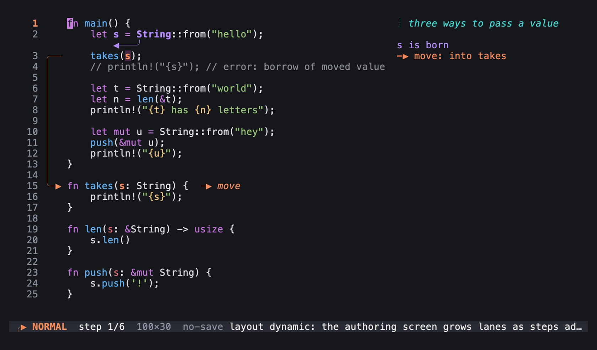
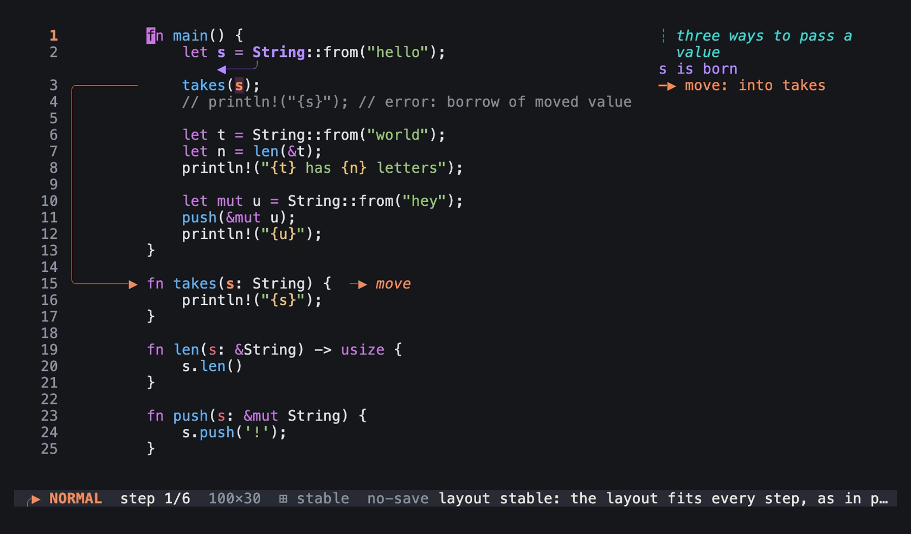

# View commands

Use these commands to change how Tiza shows the code. Tiza saves the theme, the title, the line numbers, the padding and the margin in the document. Exports use the theme, the line numbers and the margin. A Markdown export shows the title above the code. An SVG export writes it as the SVG title, which it does not draw.

Each image on this page is a frame of a `tiza render` export, except the images of `:focus`, `:pad` and `:layout`. The code is `examples/ownership.rs`. A frame shows only what an export draws, so some commands have no frame. An export does not draw the focus, the padding of the TUI or the layout of normal mode, so the images of these commands show the TUI.

## `:focus`

Dims all the lines except a range. `:focus` alone clears the focus.

```
:focus A-B
:focus
```

For example, `:focus 6-8` dims all the lines except 6 to 8.



`:focus 6-8` at step 3 of `examples/ownership.rs.tiza` in normal mode: an image of the TUI in a real terminal of 100 columns and 30 rows, with the Menlo font.

- `:focus` takes lines that are in the code. When `B` is after the last line, Tiza stops the focus at the last line.
- A range can also be `A..B` or `A:B`. Write it without spaces.
- `Esc` in normal mode also clears the focus. `h` on a line selection sets it.
- Tiza does not save the focus. `:export` shows it, but `tiza render` does not. To dim lines at one step, use [`:spot`](annotate.md#spot).

## `:theme`

Sets the theme, or changes between the dark and the light theme.

```
:theme NAME
:theme
:theme auto
:theme file PATH
```

For example, set the light theme:

<!-- frame id=theme-light code=examples/ownership.rs:1-3 theme=doc -->
```
:theme light
:hl 3:takes
```


### Notes on `:theme`

- `:theme` alone does the same as `t`.
- `:theme auto` follows the theme of the terminal again. The document then names no theme. See [The auto theme](../themes.md#the-auto-theme).
- `:theme file PATH` loads the theme tokens from a TOML file.
- The names of the themes are in [Theme names](../themes.md#theme-names).

## `:lang`

Sets the language of the code, finds it again, or shows it.

```
:lang LANG
:lang auto
:lang
```

For example, `:lang py` shows the code as Python.

- `LANG` is a language id, for example `rs`, `ts` or `py`.
- `:lang auto` finds the language again. `:lang` alone shows the language.
- How Tiza finds the language is in [How Tiza finds the language](../cli.md#how-tiza-finds-the-language).

## `:title`

Sets the title of the document. `:title` alone removes the title.

```
:title TEXT
:title
```

For example, `:title Ownership`.

## `:numbers`

Shows or hides the line numbers.

```
:numbers on
:numbers off
```

For example, hide the line numbers:

<!-- frame id=numbers-off code=examples/ownership.rs:1-3 -->
```
:numbers off
```


### Notes on `:numbers`

- `:numbers` alone shows the current value.
- A document without `numbers` uses `numbers` of the config file, else it shows the line numbers. `:numbers on` and `:numbers off` write the value into the document, also when the config file gives the same value. See [Which value wins](../config.md#which-value-wins).
- `tiza render --numbers` and `--no-numbers` change the line numbers for one export.

## `:pad`

Sets the blank cells around the code and its annotations: `V` rows and `H` columns.

```
:pad V [H]
:pad default
```

For example, `:pad 0 0` removes the padding.



Step 3 of `examples/ownership.rs.tiza` with the padding of the document, 1 row and 2 columns: an image of the TUI in a real terminal of 100 columns and 30 rows, with the Menlo font.



The same step after `:pad 0 0`. The document now has changes that are not saved, because `:pad` writes the padding into the document: an image of the TUI in a real terminal of 100 columns and 30 rows, with the Menlo font.

- `:pad default` removes the padding of the document. The padding is then `pad` of the config file, else 0 rows and 1 column. The message ends with `(from config.toml)` or `(default)`.
- `:pad V` sets `H` to two times `V`.
- `:pad` also takes `V,H` with a comma. Tiza ignores the values after `H`.
- `:pad` alone shows the current value.

## `:margin`

Sets the largest width of the right margin, from 12 to 200 cells. Tiza puts notes, labels and legends in the right margin when it has room, and under the line when it has no room. In the right margin, a note wraps onto the rows under its line. Tiza cuts a label, a legend, or a note that is too long for its rows, and ends it with `…`.

```
:margin N
:margin auto
```

For example, `:margin 40` limits the right margin to 40 cells. In this frame, `:margin 20` cuts a long note at 20 cells, and ends it with `…`. Line 3 is the last line of the code, so no row is free under it:

<!-- frame id=margin-20 code=examples/ownership.rs:1-3 width=80 -->
```
:note 3 s moves into takes, and main can no longer use it
:margin 20
```



- `:margin auto` removes the limit. The right margin then takes the width that the code leaves.
- `:margin` alone shows the current value.
- `tiza render --margin-cols` changes the margin for one export.

## `:layout`

Sets the layout of normal mode.

```
:layout stable
:layout dynamic
```

- `:layout stable` uses the take while you edit. The status bar shows `⊞ stable`.
- `:layout dynamic` lets the layout grow as the steps add arrows.
- Presentation mode and exports always use the take.
- `:layout` alone shows the current value.
- `:layout` changes only this session. The document does not keep it. `layout` in the config file sets the layout at start. See [`[defaults]`](../config.md#defaults).



`:layout dynamic` at step 1 of `examples/ownership.rs.tiza`: an image of the TUI in a real terminal of 100 columns and 30 rows, with the Menlo font.



`:layout stable` at the same step. The lanes of the arrows of later steps are there already, as in presentation mode and the exports: an image of the TUI in a real terminal of 100 columns and 30 rows, with the Menlo font.

## `:mouse`

Turns mouse capture on or off, or shows its state.

```
:mouse on
:mouse off
:mouse
```

The mouse is in [Use the mouse](../../guides/present.md).
