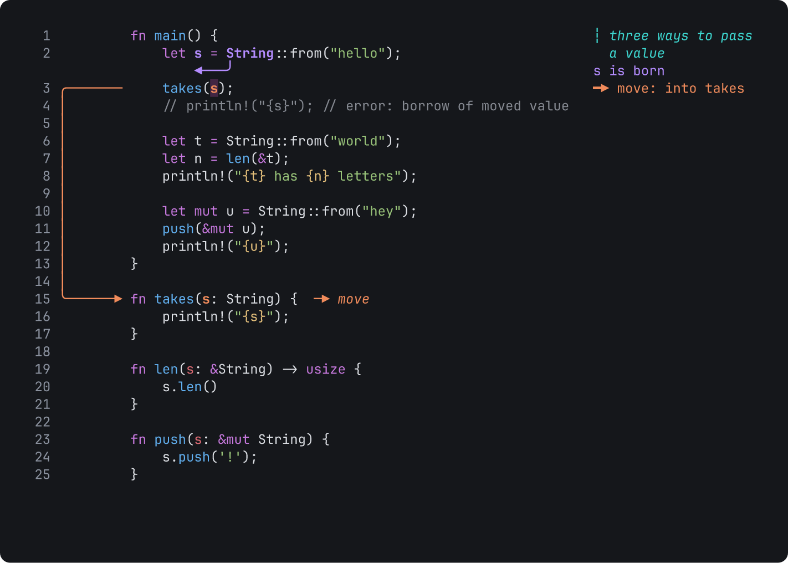

# Tiza v0.2.1

**Draw on top of code in your terminal to explain, debug and teach.**

This release makes presenting easier. Typed code no longer blinks, and the end of the code stays in view when the terminal gets smaller. The release also adds `tiza close`, a lesson and two guides, and it fixes bugs that you can see. A document of v0.2.0 opens in v0.2.1. See [Before you update](#before-you-update) for the changes that can stop a script.



Report a bug that you can reproduce with the [bug report form](https://github.com/luiscarlosjayk/tiza/issues/new/choose). Put feedback, ideas and terminal reports in [Discussions](https://github.com/luiscarlosjayk/tiza/discussions).

## What is new

- **Typed code keeps its colors.** While Tiza types the code of a step, each line has the colors of the code at the end of the step, in the TUI and in the GIF, WebP and MP4 exports. Before, an open bracket or quote changed the colors of the lines below it until it closed, and the lines blinked. See [Typing](https://tiza.luisk.dev/reference/document-format/#typing).
- **The end of the code stays in view.** In presentation mode, when the view shows the end of the code and the terminal changes size, the last line stays above the step counter. Before, the last lines went off the screen in a smaller terminal, for example when you moved the divider of a split pane or made the font bigger.
- **A session has one instance.** When a session has a live instance, a second `tiza FILE` in that session does not start. This includes the default session. Its message tells how to close the first instance or how to open the file in another session. Before, the second one started without a socket, and agents and the step commands talked to the first one. See [Before you update](#before-you-update).
- **New pages:**
  - [Getting started](https://tiza.luisk.dev/getting-started/), a lesson of about 10 minutes.
  - [Present a take](https://tiza.luisk.dev/guides/present-a-take/), from a finished document to a presentation.
  - [Animate an explanation](https://tiza.luisk.dev/guides/animate-an-explanation/), an explanation that plays by itself.
- **`tiza close`** closes the instance of a session from another terminal, as `:q` does, and waits until it exits. Use it when you lost the terminal of a presentation. With unsaved changes, it refuses and exits with code 1. `tiza close --force` closes the instance, and the changes are lost. The socket method `app.quit` does the same for a script, and it refuses with the new error code `unsaved_changes`. No MCP tool sends it. See [Close an instance](https://tiza.luisk.dev/reference/cli/#close-an-instance).
- **Tiza quits in order after `kill`.** After `kill` or `kill -INT`, Tiza quits as with Ctrl-C: the terminal comes back, the socket goes, and Tiza prints what it did not save. A second signal ends Tiza at once. Before, the signal ended Tiza at once, and the socket stayed.

## Changes and fixes

- A box puts its top and bottom borders on the blank lines beside it, when no annotation is on those lines. Thus a box that comes in at a later step does not move the code down, and the box takes 2 rows fewer. See [Notes on `:box`](https://tiza.luisk.dev/reference/commands/annotate/#notes-on-box).
- In presentation mode, when `q` does not quit, the last row says why for 2 seconds. Before, the last row did not change.
- An animated export (GIF, WebP, MP4 or WebM) types the code in the same time as the screen. Before, a fast typing (`speed_ms` less than 20) took much more time, and `"char"` at the default speed took 20 % more time.
- A step that types plays its moves in the order of the list. Each move changes the code in its turn and takes its own time on the screen, also after a faster move, and a `wait` waits its full time. Before, every move of the step changed the code when the step started.
- While a step types a long line, a box keeps its width.
- `J` and `K` move the cursor by half the rows of code on the screen, as they move the view in presentation mode.
- A long label in the right margin that has no free row goes under its line of code, whole, when it fits there. Before, Tiza cut it with `…`. In a drawing or in other text, Tiza still cuts it, and `tiza check` tells you.
- A label beside a margin callout stays there only when it fits whole. Otherwise it goes under its line. Before, normal mode could cut such a label with `…`, while presentation mode showed it whole.
- A margin callout that shares its line with a note goes back to the margin when the note goes under the line and the callout fits there. Before, the callout could be a block under its line, and the code took more rows.
- The message of `u` or `U` goes away from the status bar when a later edit comes in. Before, it could say the opposite of the screen.
- `:step N` to the empty step after the last step (where you add the annotations of a new step) shows the code of the last step, with the moves of every step before it.
- In a terminal that draws `⚠`, `↪`, `⏸` or `▶` two cells wide, the status bar fits its row also when Tiza starts with the cursor at the right edge of the terminal.
- A mark style with an empty `legend` shows the label right after the glyph: `+ label`. Before, it showed `+ : label`.
- In a Markdown file, a fenced code block indented by 1 to 3 spaces, for example in a list item, gets the colors of its language. Before, the rest of the file lost its colors too.
- Tiza no longer stops when the terminal sends Escape and `[` together, as many terminals do for Alt+`[`.
- With `--theme auto`, a resize no longer puts the rest of a color answer on the command line. A resize while Tiza starts sends the color query again.
- Tiza measures the width of text with the tables of Unicode 18. A few characters change their width, for example the voiced sound marks of halfwidth katakana (`ﾞ` and `ﾟ`) now take one cell. Your documents do not change.
- The guide [Use the mouse](https://tiza.luisk.dev/guides/use-the-mouse/) has a new address. The old address goes to the new page.
- The JSON Schema and the MCP tool `update_annotation` no longer give `to_line` for a note. Tiza refuses it.

The [CHANGELOG](https://github.com/luiscarlosjayk/tiza/blob/v0.2.1/CHANGELOG.md) has the full list.

## Before you update

- **`tiza check --width N` takes the width of the terminal that you record in.** It takes off the side padding, as the TUI does: the `padding` of the document, else `pad` of the config file, else 1 column at each side. If a script gives `--width` the columns of code, add the padding of both sides. Without `--width`, the default width (`width` of the config file, else 100) is also the width of a terminal, so the result can change. `tiza render --width` and the `check` of the socket and MCP keep columns of code. See [The width line](https://tiza.luisk.dev/guides/check-before-you-record/#the-width-line).
- **One instance for each session.** A second `tiza FILE` in a session that has a live instance exits with code 1. Two `tiza FILE` in two panes without `--session` no longer both start. Give each one its own `--session NAME`, or start one with `--no-socket`.
- **Exit codes after a signal.** After SIGTERM, Tiza exits with code 143. After SIGINT, it exits with code 130.
- **A spotlight that never shows is refused.** The API, the MCP tools, `:until`, `:step ID S`, `:set ID step=S` and the `+` key refuse a spotlight whose `until` is before its `step`. The API and MCP give `invalid_argument`. The message gives the fix first. A `.tiza` file, `scene.put` and `scene.patch` still accept such a spotlight, and `tiza check` reports it.

## Install

On macOS, and on Linux x86_64 with glibc 2.35 or later, run this command:

```sh
curl -fsSL https://raw.githubusercontent.com/luiscarlosjayk/tiza/main/install.sh | sh
```

The script checks the SHA-256 checksum of the download. Then it puts `tiza` in `~/.local/bin`. To update from an earlier version, run the same command.

To install an archive yourself, use the file for your system:

| System | File |
|---|---|
| macOS, Apple Silicon | `tiza-v0.2.1-aarch64-apple-darwin.tar.gz` |
| macOS, Intel | `tiza-v0.2.1-x86_64-apple-darwin.tar.gz` |
| Linux x86_64 (glibc 2.35 or later: Ubuntu 22.04, Debian 12, Fedora 36 or later) | `tiza-v0.2.1-x86_64-unknown-linux-gnu.tar.gz` |

1. Download the file for your system and its `.sha256` file.
2. Check the file: `shasum -a 256 -c tiza-v0.2.1-<target>.tar.gz.sha256`. On Linux, you can use `sha256sum -c`.
3. Extract the file: `tar -xzf tiza-v0.2.1-<target>.tar.gz`
4. Make a folder in your PATH if you do not have one: `mkdir -p ~/.local/bin`
5. Copy `tiza` to that folder: `cp tiza-v0.2.1-<target>/tiza ~/.local/bin/`

**macOS:** The binaries do not have an Apple Developer ID signature. If you download the file with a web browser, macOS stops Tiza the first time and shows *"tiza" Not Opened*. To fix this, run this command one time: `xattr -d com.apple.quarantine ~/.local/bin/tiza`. A download with `curl` or with the install script does not have this problem.

**From source** (Rust 1.88 or later): run `cargo install tiza`. The `tiza` binary contains libwebp, a C library, so `cargo install` also needs a C compiler. On macOS, install the Xcode Command Line Tools. On Debian and Ubuntu, install the `build-essential` package.

Tiza does not support Windows in version 0.x.

## Known limits

- Enter effects are an experiment. They can change or go away in a later version.
- We tested Tiza on macOS in the Zed terminal and in Herdr. Other terminals with 24-bit color and box-drawing characters should work. We did not test tmux and other terminals ([Terminal support](https://tiza.luisk.dev/reference/terminals/)).
- Use `find` to target a code change in a step, not a line number. If you edit the file while Tiza is closed, a change by line number applies to the lines that are at that number now.

## More information

To get a notice of new versions, watch the repository on GitHub (**Watch** → **Custom** → **Releases**).

[Docs](https://tiza.luisk.dev) · [README](https://github.com/luiscarlosjayk/tiza#readme) · [Agent setup](https://tiza.luisk.dev/agents/setup/) · [CHANGELOG](https://github.com/luiscarlosjayk/tiza/blob/v0.2.1/CHANGELOG.md)
