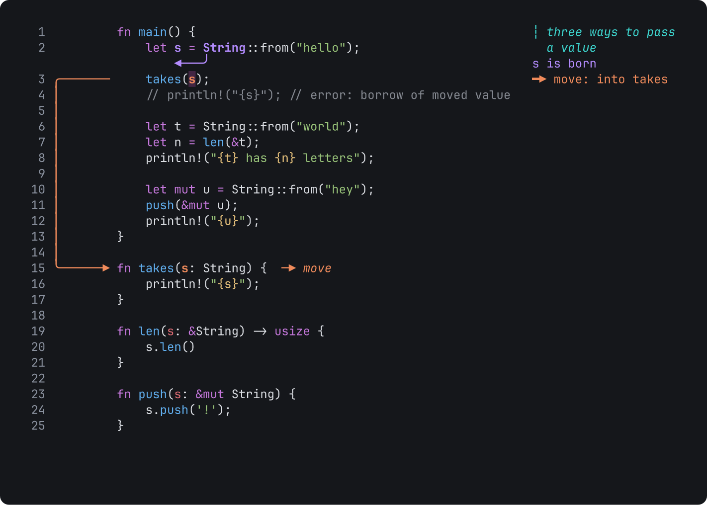

# Tiza v0.3.0

**Draw on top of code in your terminal to explain, debug and teach.**

This release is about long talks. A talk plays several `.tiza` documents in a row, from one master file, and you present it with no script. The release also lets each annotation go at a later step, puts a title slide in the middle of the screen, and shows which lines a step writes and removes. A document of v0.2.1 opens in v0.3.0. See [Before you update](#before-you-update) for the changes that can stop a script or an older Tiza.



Report a bug that you can reproduce with the [bug report form](https://github.com/luiscarlosjayk/tiza/issues/new/choose). Put feedback, ideas and terminal reports in [Discussions](https://github.com/luiscarlosjayk/tiza/discussions).

## What is new

- **A talk plays several documents in a row.** A master `.tiza` has `talk`, with the list of its scenes, in place of `code`. `tiza talk.tiza --present` opens it. `n` at the last step of a scene goes to the next scene, and `p` goes back. Each scene keeps its own layout, theme and padding, and looks as it does when you open it alone. `q` quits, and autosave stays on. When Tiza closes, it writes the place in the talk into the master, and the next `tiza talk.tiza` opens there. `--scene X` and `:scene X` go to a scene by its position or its name, and `"skip": true` leaves out a scene. `examples/ownership-talk.tiza` is an example. See [Present a long talk](https://tiza.luisk.dev/guides/present-a-long-talk/).
- **Check and export a talk.** `tiza check talk.tiza` checks each scene with its own layout, and gives the narrowest terminal at which every scene shows its labels whole. `tiza render talk.tiza --out talk.mp4` (or GIF, WebP or WebM) plays the scenes in a row, each with its own theme and typing. See [Check and export the talk](https://tiza.luisk.dev/guides/present-a-long-talk/#3-check-and-export-the-talk).
- **The counter and a progress bar count the whole talk.** In presentation mode, the step counter counts the keys of the whole talk, not of the scene. A thin progress bar on the same row grows at each key. With `progress = "scene"` in the config file, or `--progress scene`, the bar moves only when the talk goes to the next scene. `--no-counter` hides the numbers, and `--no-progress` hides the bar. The theme token `progress_bar` gives the color of the bar. See [Present the talk](https://tiza.luisk.dev/guides/present-a-long-talk/#4-present-the-talk).
- **The title of a talk goes on the terminal tab.** In presentation mode, the `title` of the master shows on the tab. Tiza gives back the old title when you stop presenting or quit.
- **An agent can drive a talk and change it.** The MCP tools `talk_status`, `goto_scene`, `set_talk_scenes` and `insert_scene`, and the socket methods `talk.*`, give the talk, go to a scene, and change the list of scenes. See [Drive a talk](https://tiza.luisk.dev/agents/drive-a-talk/).
- **Each annotation can go at a later step.** `until` gives the last step that shows an annotation. Before, only a spotlight had it. After its `until`, the annotation and its label go, and the code under it shows as before. Type `:until ID N`. See [`:until`](https://tiza.luisk.dev/reference/commands/annotate/#until).
- **`"center": true` puts the code in the middle of the screen.** All the steps go to the same place, at each terminal size, with no blank lines or spaces for one size. Use it for a title slide. `:center on` sets it. See [`center`](https://tiza.luisk.dev/reference/document-format/#top-level-fields).
- **A step can show what it changes.** A `code.patch` move with `"diff": true` shows a `+` next to each line that it writes, and each line that it removes on a row of its own with a `−`. At the next step, the signs and the removed lines go. The theme tokens `diff_add` and `diff_del` give their colors. `examples/borrow-diff.rs.tiza` is an example. See [A diff](https://tiza.luisk.dev/reference/document-format/#a-diff).
- **A diff on standard input gets its colors.** `git diff | tiza` and `git diff | tiza render -` show the diff with the colors of a `.diff` file. Before, it was plain text. See [How Tiza finds the language](https://tiza.luisk.dev/reference/cli/#how-tiza-finds-the-language).

## Changes and fixes

- A step that types a line past line 9 does not move the code. Before, the code moved one column to the right in the middle of the typing, when a line number got one more digit.
- A patch that moves or changes the target of a `scroll` after a `wait` does not move the code at the next step. Before, the code went up or down by the lines of the patch.
- `--no-counter` hides the step counter of presentation mode, and the last row shows code again. `counter = false` in the config file hides it for every session.
- In a talk, a title slide with no annotations, and no moves after step 0, has only one step. It takes one key, also in an export.
- The reference of the command line and of the document format gives the options and the fields as lists, each with its notes, its type and its default.
- The `hidden` reply of an annotation after its `until` is `it shows only at steps A-B` or `it shows only at step N`, for each type.

The [CHANGELOG](https://github.com/luiscarlosjayk/tiza/blob/v0.3.0/CHANGELOG.md) has the full list.

## Before you update

- **The document format has version 2.** Tiza writes `"schema": 2` only when a document needs it: an `until` on an annotation that is not a spotlight, `center`, `diff` on a move, or the master of a talk. Tiza 0.2.1 and earlier versions refuse such a file. Other documents keep `"schema": 1`, and older versions open them as before. If you share a document with a person who has an older Tiza, ask them to update. See [`schema`](https://tiza.luisk.dev/reference/document-format/#top-level-fields).
- **`until` in the API.** `annotation.update` with `shape` replaces the `until` too, and a `shape` without `until` removes it. A request with `until` and also a `shape` fails with `invalid_argument`. `scene.patch` keeps the `until` of an annotation that it replaces when the new annotation has no `until` key. `"until": null` removes it.
- **The `hidden` reply of a spotlight changed.** It was `a spotlight shows from step A to B` or `a spotlight shows only at its step N`. A script that reads it must read the new text.
- **For code that uses the crates.** `tiza_core::highlight::TypedHighlight` has a new field, `end_last_line`, and `tiza_core::anim::AnimOptions` has a new field, `in_talk`. Code that makes one of them with all its fields must give the new field. `AnimOptions::default()` gives `false`.

## Install

On macOS, and on Linux x86_64 with glibc 2.35 or later, run this command:

```sh
curl -fsSL https://raw.githubusercontent.com/luiscarlosjayk/tiza/main/install.sh | sh
```

The script checks the SHA-256 checksum of the download. Then it puts `tiza` in `~/.local/bin`. To update from an earlier version, run the same command.

To install an archive yourself, use the file for your system:

| System | File |
|---|---|
| macOS, Apple Silicon | `tiza-v0.3.0-aarch64-apple-darwin.tar.gz` |
| macOS, Intel | `tiza-v0.3.0-x86_64-apple-darwin.tar.gz` |
| Linux x86_64 (glibc 2.35 or later: Ubuntu 22.04, Debian 12, Fedora 36 or later) | `tiza-v0.3.0-x86_64-unknown-linux-gnu.tar.gz` |

1. Download the file for your system and its `.sha256` file.
2. Check the file: `shasum -a 256 -c tiza-v0.3.0-<target>.tar.gz.sha256`. On Linux, you can use `sha256sum -c`.
3. Extract the file: `tar -xzf tiza-v0.3.0-<target>.tar.gz`
4. Make a folder in your PATH if you do not have one: `mkdir -p ~/.local/bin`
5. Copy `tiza` to that folder: `cp tiza-v0.3.0-<target>/tiza ~/.local/bin/`

**macOS:** The binaries do not have an Apple Developer ID signature. If you download the file with a web browser, macOS stops Tiza the first time and shows *"tiza" Not Opened*. To fix this, run this command one time: `xattr -d com.apple.quarantine ~/.local/bin/tiza`. A download with `curl` or with the install script does not have this problem.

**From source** (Rust 1.88 or later): run `cargo install tiza`. The `tiza` binary contains libwebp, a C library, so `cargo install` also needs a C compiler. On macOS, install the Xcode Command Line Tools. On Debian and Ubuntu, install the `build-essential` package.

Tiza does not support Windows in version 0.x.

## Known limits

- Enter effects are an experiment. They can change or go away in a later version.
- We tested Tiza on macOS in the Zed terminal and in Herdr. Other terminals with 24-bit color and box-drawing characters should work. We did not test tmux and other terminals ([Terminal support](https://tiza.luisk.dev/reference/terminals/)).
- Use `find` to target a code change in a step, not a line number. If you edit the file while Tiza is closed, a change by line number applies to the lines that are at that number now.
- An export of a talk centers a scene with `center` across, but not down. A lower scene is at the top of the frame.
- `--theme-file`, `--lang` and `:saveas` do not work with a talk. Put the theme and the language in each scene.

## More information

To get a notice of new versions, watch the repository on GitHub (**Watch** → **Custom** → **Releases**).

[Docs](https://tiza.luisk.dev) · [README](https://github.com/luiscarlosjayk/tiza#readme) · [Agent setup](https://tiza.luisk.dev/agents/setup/) · [CHANGELOG](https://github.com/luiscarlosjayk/tiza/blob/v0.3.0/CHANGELOG.md)
